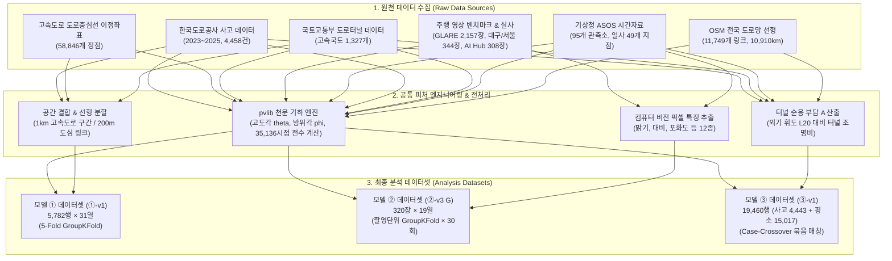

# [데이터 명세서] 3조(눈치) 데이터 명세서: 머신러닝 기반 도로 환경별 태양 눈부심 위험 모니터링 시스템
> **프로젝트 성격**: 머신러닝 모델 기반 자유주제 팀 프로젝트 (팀 「눈치」 Nunchi-ML)  
> **문서 버전**: v1.0 (노션 데이터 명세서 v0.12 및 모델링 계획서 v1.5 통합 정본)  
> **작성 일자**: 2026-11-03 (프로젝트 4일차)  
> **담당 작성자**: 박범수 (모델 ① 담당), 이성진 (모델 ② 담당), 최재혁·권수영 (모델 ③ 담당)  
> **제출 기한**: 2026-11-03 18:00 🚨  

---

## 1. 프로젝트 및 데이터 개요

### 1.1 프로젝트 배경 및 목적
주행 중 저각도 태양 직사광선과 터널 입·출구의 급격한 조도 변화는 운전자에게 심각한 시각 장애(불쾌/불능 눈부심 및 순응 지연)를 유발하여 대형 추돌 사고로 직결됩니다. 본 프로젝트는 **도로 기하구조(방위각·곡률), 정밀 천문 궤적(pvlib), 기상 관측소(ASOS) 실측치, 차량 전면 영상 비전 특징을 유기적으로 결합**하여 도로 환경별 눈부심 위험도를 다층적으로 분석·예측하는 머신러닝 파이프라인을 구축합니다.

### 1.2 시스템 아키텍처 및 3대 서브모델 데이터 구성
SunSight는 도로 유형과 분석 수준에 따라 세 가지 특화 모델로 데이터를 분할 구축합니다:
* **모델 ① (고속도로 사고 위험 예측 & 도심 Layer 1 잠재 노출 스크리닝)**: 전국 고속도로 5,782개 1km 구간의 도로 기하구조와 연간 태양 궤적 적분치 기반 사고 발생 위험($\lambda$) 예측 및 도심 달구벌대로 164개 링크 물리 노출 스크리닝.
* **모델 ② (주행 영상 기반 눈부심 시각 증거 분류)**: 공개 벤치마크(GLARE), 한국 도로(대구·서울 Mapillary), AI Hub 특수환경 역광 영상의 12개 비전 특징 및 화각 반영 태양·기상 입력(G) 기반 눈부심 분류.
* **모델 ③ (터널 진입·진출 순응 부담에 따른 사고 위험 분석)**: 전국 1,327개 고속국도 터널 입·출구에서의 급격한 조도 차이에 따른 명·암순응 부담($A$)과 사고 발생 간의 조건부 로지스틱(Case-Crossover) 분석.

---

## 2. 공통 데이터 파이프라인 및 거버넌스 규칙

### 2.1 천문 기하학적 태양 위치 계산 규약 (pvlib Solar Engine)
* **산출 도구**: `pvlib.solarposition.get_solarposition`
* **투입 인자**: 관측 일자 및 시각(KST, UTC+9), 관측 지점 위도·경도(WGS84).
* **산출 변수**:
  - 태양 고도각 ($\theta_{\text{alt}}$, 단위: 도, 수평선 = $0^\circ$, 천정 = $90^\circ$)
  - 태양 방위각 ($\phi_{\text{sun}}$, 단위: 도, 정북 = $0^\circ$, 시계방향)
* **공통 저각도 역광 충족 조건식 (Circular Distance 적용)**:
  $$\Delta\phi_i(t) = \min\left(|\phi_{\text{sun}}(t) - \phi_i|, \ 360^\circ - |\phi_{\text{sun}}(t) - \phi_i|\right)$$
  $$\text{Condition: } 0^\circ < \theta_{\text{alt}}(t) \le 25^\circ \quad \land \quad \Delta\phi_i(t) \le 25^\circ$$

### 2.2 미래 데이터 누수(Data Leakage) 원천 차단 원칙
타깃 사건이 발생한 **이후에 생성되거나 관측 시점 이후의 정보를 포함하는 변수**는 모델 입력 피처에서 전면 배제합니다.

| 모델 | 의심 변수명 | 누수 원인 분석 | 처리 결정 및 통제 방안 | 확정자 / 일자 |
| :---: | :--- | :--- | :--- | :---: |
| **모델 ①** | 사고원인, 사망자수, 부상자수 | 사고 발생 후 조사 과정에서 기록되는 사후 결과치임 | **입력 피처 전면 제외** (단, 사후 심각도 대조 검증용으로만 보조 집계) | 박범수 (2026-11-02) |
| **모델 ②** | 기상청 ASOS 일조시간(`ss`), 일사량(`icsr`) | 촬영 시각과 가장 가까운 정시 관측치를 사후 매핑할 경우, 최대 30분의 미래 기상 정보 혼입 가능 | **실시간 서비스 및 추론 시 직전 정시 관측치만 참조하도록 정합성 강제** | 이성진 (2026-11-03) |
| **모델 ③** | 사고원인 | 사고 조사관의 사후 판정 기록임 | **입력 피처 전면 제외** | 최재혁 (2026-11-02) |

### 2.3 데이터셋 버전 및 모델별 데이터 분할·평가·추정 규칙
* **버전 명명 형식**: `[모델 번호]-[버전]` (예: `①-v1`, `②-v3`, `③-v1`). 데이터셋 버전이 상이한 모델 간에는 성능 지표를 상호 비교하지 않습니다.
* **모델별 데이터 분할·평가 및 추정 규칙**:
  - **공통 분할 원칙**: 예측 모델(①·②)은 동일 도로 노선이나 동일 촬영 묶음이 학습과 시험에 섞이는 공간·시계열 누수를 막기 위해 `GroupKFold(n_splits=5)` 그룹 분할을 기본 원칙으로 합니다.
  - **모델 ① (도로 노선 단위 5-Fold 교차검증)**: 61개 고속도로 노선(`route_name`) 기준 `GroupKFold(n_splits=5)` 분할 (`random_state=0` 고정, `folds_model1_v1.csv`).
  - **모델 ② (촬영 묶음 단위 5-Fold & 30회 반복 / 카메라 홀드아웃 평가)**: 시범(`②-v0`) 및 기본 평가는 영상·촬영 묶음 기준 `GroupKFold(n_splits=5, random_state=0)`을 적용합니다. 단, `②-v3 (G)` 정본(320장)은 독립 촬영 묶음이 24개로 작아 단일 분할 시 폴드 편차가 커지므로, **촬영 단위 `GroupKFold(n_splits=5, shuffle=True, random_state=0..29)` 30회 반복 분할(평균±표준편차)** 과 **카메라 1대 홀드아웃(Leave-One-Camera-Out)** 일반화 시험을 병행합니다.
  - **모델 ③ (사건 층 매칭 설계 및 조건부 로지스틱 추정)**: 교차검증 분할 대신 사고 1건과 동일 지점·월·요일·시각의 대조군 3~4건을 하나의 사건 층(`case_id`)으로 매칭하는 Case-Crossover 설계 및 조건부 로지스틱 회귀 추정을 적용합니다.

---

## 3. 모델 ①: 고속도로 사고 위험 예측 & 도심 Layer 1 스크리닝

### 3.1 원천 데이터 수집 명세
| 데이터명 | 원본 파일 경로 | 원본 규모 | 수집 기간 | 원천 출처 |
| :--- | :--- | :---: | :---: | :--- |
| **고속도로 사고** | `expressway/한국도로공사_사고이정별좌표및기상_2023-2025.csv` | 4,458행 × 13열 | 2023.01.01 ~ 2025.12.31 | 공공데이터포털 (No.15164206) |
| **도로중심선 좌표** | `expressway/한국도로공사_도로중심선_이정좌표.csv` | 58,846행 × 7열 | 2025년 기준 | 고속도로 공공데이터 포털 (No.S0) |
| **전국 도로터널** | `tunnel/국토교통부_전국도로터널정보표준데이터.csv` | 3,840행 × 33열 | 2025.12 기준 | 공공데이터포털 (No.15081955) |
| **도심 도로망 (달구벌대로)** | `Nunchi-ML_FE/src/data/dalgu.json` | 164개 링크 (32.81km) | 2026년 실측 | 대구광역시 도시철도 2호선 축선 OSM |

### 3.2 모델 ① 원본 변수 정의서
| 원천 | 변수명 | 물리적 의미 | 데이터 타입 | 유효 범위 / 범주 | 결측치 | 정제 및 결측 처리 방안 | 모델 활용 |
| :--- | :--- | :--- | :---: | :---: | :---: | :--- | :---: |
| 사고 | `사고일자`, `사고시간` | 사고 발생 일시 (분 단위) | 문자열/날짜 | 2023-01-01 ~ 2025-12-31 | 0건 | `YYYY-MM-DD HH:MM` 결합 파싱 | 타깃 산출 |
| 사고 | `사고노선` | 고속도로 세부 노선명 | 범주형 | 61개 세부 노선 | 0건 | 노선 표준 명칭 매핑 | GroupKFold 키 |
| 사고 | `사고발생이정` | 노선 기점 기준 위치 (km) | 연속형 | 0.0 ~ 420.0 km | 0건 | 1km 구간 인덱스 floor 매핑 | 공간 결합 |
| 사고 | `사망`, `부상` | 인명 피해 규모 | 정수형 | 사망 0~3명, 부상 0~25명 | 0건 | 결측 없음 (EPDO 미적용 단순 집계) | 검증 참조 |
| 사고 | `기상상태` | 사고 당시 날씨 기록 | 범주형 | 맑음(3,365건), 흐림, 비 등 | 0건 | 맑은 날 정면 역광 대조군 식별 | 검증 참조 |
| 사고 | `X좌표`, `Y좌표` | 사고 발생 지점 위·경도 | 연속형 | 위도 34.8~38.1°, 경도 126.3~129.4° | 0건 | 개별 사고 시각별 pvlib 정밀 계산 투입 | 타깃 산출 |
| 중심선 | `도로명` | 중심선 소속 노선명 | 범주형 | 61개 노선 | 1,313건 | 결측치 행 제거(`dropna`) $\rightarrow$ 57,533건 확보 | 공간 분할 |
| 중심선 | `이정` | 100m 단위 연속 이정 | 연속형 | 0.0 ~ 420.0 km | 0건 | 1km 구간 집계의 기준점 설정 | 구간화 |
| 중심선 | `X좌표값`, `Y좌표값` | 도로 중심선 정점 WGS84 | 연속형 | 전국 고속도로 좌표 | 0건 | 인접 정점 간 벡터 방위각 및 곡률 산출 | 기하 피처 |
| 터널 | `도로종류` | 도로 행정 등급 | 범주형 | 고속국도, 일반국도 등 | 0건 | 고속국도(1,327개)만 엄격 필터링 | 필터링 |
| 터널 | `터널연장` | 터널 총 길이 (m) | 연속형 | 50 ~ 10,965 m | 0건 | 1km 구간 내 최대 터널 연장 집계 | 모델 입력 |
| 터널 | `시점/종점좌표` | 터널 입·출구 위·경도 | 연속형 | WGS84 위경도 | 0건 | 1km 구간 중심점 기준 최근접 거리 계산 | 모델 입력 |

### 3.3 데이터 정제 및 피처 엔지니어링 6단계 파이프라인
1. **개별 사고-태양 정밀 기하 결합**: 4,458건 사고 각각의 발생 시각과 위·경도를 `pvlib`에 투입, 저각도 정면 역광 조건($\theta_{\text{alt}} \le 25^\circ, \Delta\phi \le 25^\circ$)을 만족하는 **정면 역광 사고 99건**을 정밀 레이블링.
2. **1km 구간화 및 도로 기하구조 산출**: 정제된 57,533개 중심선 정점을 1km 단위 5,782개 구간으로 분할하고, 100m 정점 벡터 간 방위각 변화율로부터 구간 평균 곡률(`curvature_mean`), 최대 곡률(`curvature_max`), 동서축 정렬도(`ew_alignment`) 도출.
3. **고속국도 터널 인프라 매핑**: 1,327개 고속국도 터널 입·출구 좌표를 공간 조인하여 구간 내 터널 유무(`has_tunnel_within_1km`), 최근접 터널 거리(`min_tunnel_dist_km`), 최대 터널 연장(`max_tunnel_length_1km`) 결합.
4. **2024년 윤년 35,136시점 전수 태양 시뮬레이션**: 2024년 366일 전체(15분 단위) 태양 궤적을 대표 좌표계에서 전수 계산하여, 각 구간 순방향 주행 시 정면 저각도에 노출되는 연간 누적 시수(`annual_glare_hours_fwd`) 및 출퇴근 피크 시수(`commute_glare_hours`) 산출.
5. **타깃 집계 및 최종 학습셋 구축 (`①-v1`)**: 1km 구간별로 3개년 정면 사고 건수(`glare_front_count`, 99건)와 24시간 전체 사고 건수(`accident_count`, 4,454건, 램프구간 4건 제외)를 매핑. 무사고 4,117개 구간은 0으로 결합.
6. **노선 단위 GroupKFold 5-Fold 분할 (`folds_①-v1`)**: 61개 세부 노선이 학습과 검증에 혼입되지 않도록 노선 단위 그룹화 분할 (폴드당 약 1,156개 구간 배치, 공간 누수 차단).

### 3.4 모델 ① 파생변수 명세 (12개 입력 피처)
| 파생변수명 | 산출 공식 및 알고리즘 | 공학적 의도 및 설계 목적 | 중요도 (Gain) | 성능 기여도 |
| :--- | :--- | :--- | :---: | :--- |
| `annual_glare_hours_fwd` | $\sum_{t=1}^{35136} \mathbb{I}(0^\circ < \theta_{\text{alt}} \le 25^\circ \land \Delta\phi_i \le 25^\circ) \times 0.25$ | 구간별 연간 정면 저각도 역광 총 노출량 | **59.8% (1위)** | Deviance -8.5% 감소, 상위 10% 포착률 2배 상승 |
| `ew_alignment` | $|\sin(\text{radians}(\phi_{\text{bearing}}))|$ ($0$=남북, $1$=동서) | 일출·일몰 태양 궤적 취약 동서축 정렬도 | **17.5% (2위)** | 주요 기하 구조 핵심 분할 기준 |
| `min_tunnel_dist_km` | $\min(\text{distance}(\text{segment\_mid}, \text{tunnel\_portals}))$ | 터널 입·출구 인접성 | **6.3% (3위)** | 터널 주변 시야 적응 위험 통제 |
| `curvature_mean` | 1km 구간 내 100m 정점 간 방위각 변화량 평균 | 구간 도로 굴곡도 및 곡선 위험 통제 | **5.0% (4위)** | 도로 선형 고유 물리 위험 반영 |
| `curvature_max` | 1km 구간 내 100m 정점 간 방위각 변화량 최댓값 | 급커브 및 시거 불량 위험 통제 | **4.7% (5위)** | 곡선 구간 국소 위험 제어 |
| `tunnel_glare_interaction` | $\text{has\_tunnel} \times \text{commute\_glare\_hours}$ | 터널 직후 출퇴근 역광 노출 복합 위험 | **2.6% (6위)** | 상위 10% 포착률 12.1% $\rightarrow$ 16.2% 견인 |
| `commute_glare_hours` | 출퇴근(07~09시, 17~19시) 역광 노출 시간 | 교통량 집중 시간대 피크 위험 가중 | **2.1% (7위)** | 시간대별 위험 세분화 |

### 3.5 도심 서비스 확장: 달구벌대로 Layer 1 물리 노출 데이터셋
* **공간 단위**: 대구 달구벌대로 32.81km (164개 세부 링크, 평균 링크 길이 200.1m)
* **2024년 윤년 366일 전수 시뮬레이션 지표**:
  - **Eastbound (다사 $\rightarrow$ 사월, 동진축)**: 아침 출근(07–09시) 청천 잠재 노출 최대 **423.0h** (가용시간 732h 대비 **57.79%**), 저녁 퇴근 노출 0.0h. 연간 총 노출 평균 429.9h.
  - **Westbound (사월 $\rightarrow$ 다사, 서진축)**: 저녁 퇴근(17–19시) 청천 잠재 노출 최대 **443.0h** (가용시간 732h 대비 **60.52%**), 아침 출근 노출 0.0h. 연간 총 노출 평균 377.1h.
  - **상대 분위수 등급 (Tier)**: 상위 20% High ($\ge 525.4\text{h}$), 중간 60% Med, 하위 20% Low.
  - **기하학적 강건성**: OSM 중심선 대비 P90 방위각 오차 5.74°에서도 **Tier 유지율 91.5%** 확보.

---

## 4. 모델 ②: 주행 영상 기반 눈부심 정도 분류 및 G 모델

### 4.1 원천 데이터 수집 명세
| 데이터셋명 | 파일 경로 | 이미지 규모 | 해상도 / 속성 | 원천 출처 | 라이선스 |
| :--- | :--- | :---: | :---: | :--- | :---: |
| **GLARE 벤치마크** | `glare/Images/vidN/*.png` | 2,157장 (33개 영상) | 937 × 540 | Gray et al. (2023) | CC BY 4.0 |
| **대구 도로 실사** | `glare_mapillary/` | 운전 124장, 블박 160장 | 가변 / 시각·GPS 포함 | Mapillary 실사 | CC BY-SA 4.0 |
| **AI Hub 특수환경 3D** | `aihub_special/` | 308장 (대전/서울/창원) | 1920 × 1200 / 역광 주행 | AI Hub (dataSetSn=198) | 연구용 협약 |
| **서울 도로 실사** | `glare_mapillary_seoul/` | 운전 시점 60장 | 가변 / 시각·GPS 포함 | Mapillary 전역 격자 | CC BY-SA 4.0 |
| **기상청 ASOS 실측** | `asos/daegu_143.csv`, `seoul_108.csv`, `daejeon_133.csv`, `changwon_155.csv` | 시간별 연속자료 | 전운량, 일조, 일사, 강수 | 기상청 공공데이터 (No.15057210) | 공공 개방 |
| **팀원용 데이터 번들** | `data/g_data_bundle_2026-11-03.zip` | CSV 16개 (0.35 MB) | 라벨·해위치·화각·화면숫자·ASOS 캐시 | 자체 패키징 (API 키 불필요) | 내부 공유 |

### 4.2 입력 특징 벡터 정의서 (비전 12종 + 물리/기상 G 후보 7종 [모드별 6종/4종 선택])

#### [화면 숫자 12개 비전 특징 (Computer Vision Features)]
OpenCV 기반 고속 픽셀 통계 추출기 (`src/nunchi_ml/glare/features.py`, 리사이즈 $640 \times 368$).

| 변수명 | 산출 알고리즘 및 정의 | 10~90% 분포 범위 | 물리적 의미 |
| :--- | :--- | :---: | :--- |
| `white_ratio` | $\text{mean}(I_{\text{gray}} > 245)$ | 0.00 ~ 0.14 | 카메라 센서 포화(Saturation) 면적 비율 |
| `bright_blob` | $\text{mean}(\text{GaussianBlur}(I_{\text{gray}}, 41) > 230)$ | 0.001 ~ 0.17 | 빛 번짐(Glare Bloom) 덩어리 면적 비율 |
| `mean_all` | $\text{mean}(I_{\text{gray}})$ | 96 ~ 137 | 전체 프레임 평균 밝기 (전체 조도 수준) |
| `sky_mean` | 상단 45% 영역 평균 밝기 | 137 ~ 193 | 하늘 영역 고휘도 광원 존재 여부 |
| `road_mean` | 하단 도로 영역(세로 60~85%, 가로 20~80%) 평균 밝기 | 49 ~ 138 | 주행 차선 노면의 평균 반사 조도 |
| `road_contrast`| 도로 관심 영역 밝기 표준편차 ($\sigma_{\text{road}}$) | 23 ~ 58 | 차선 및 노면 객체의 시인성 대비도 |
| `sky_road_ratio`| $\text{sky\_mean} / \max(\text{road\_mean}, 1)$ | 1.1 ~ 3.1 | 하늘과 노면 간의 역광 극단성 비율 |
| `road_sharp` | 도로 영역 라플라시안 분산 ($\text{Var}(\nabla^2 I_{\text{road}})$) | 300 ~ 2,569 | 차선 경계면의 윤곽 선명도 및 흐림 정도 |
| `low_sat` | HSV 색공간 채도 $S < 25$ 픽셀 비율 | 0.11 ~ 0.79 | 빛 번짐에 의해 색상이 탈색된 백색화 비율 |
| `brightest_x` | 블러 처리 후 최대 밝기 픽셀의 정규화 가로 좌표 | 0.0 ~ 1.0 | 최대 광원의 좌·우 시야 편향 위치 |
| `brightest_y` | 블러 처리 후 최대 밝기 픽셀의 정규화 세로 좌표 | 0.0 ~ 1.0 | 최대 광원의 상·하 시야 편향 위치 |
| `brightest_val`| 블러 처리 후 최대 밝기 픽셀의 휘도값 | 232 ~ 255 | 프레임 내 최고 광원 강도 |

#### [해 위치 및 기상 입력 후보 7종 (G Feature Set — 화각 반영 6종 / 운전자 기준 4종)]
학습 코드(`g_model_probe.py`, `g_fusion_probe.py`)에서는 아래 7개 물리·기상 변수 중 **화각 반영 모드(기본값, `G_COLS` 6종: `sun_alt`, `u`, `v`, `in_fov`, `cloud`, `sunshine`)** 또는 카메라 화각 정보가 없을 때 쓰는 **운전자 기준 모드(4종: `sun_alt`, `gap`, `cloud`, `sunshine`)** 를 선택하여 투입합니다(`u, v, in_fov`가 `gap`을 카메라 화각 평면으로 투영·대체함).

| 변수명 | 투입 모드 | 산출 공식 및 정의 | 유효 범위 | 물리적 의미 |
| :--- | :---: | :--- | :---: | :--- |
| `sun_alt` | 공통 (6종·4종) | pvlib 기반 계산 태양 고도각 ($^\circ$) | $0^\circ \sim 90^\circ$ (낮) | 태양의 지면 수직 입사각 |
| `gap` ($\Delta$) | 운전자 기준 (4종) | $|\phi_{\text{sun}} - \phi_{\text{heading}}|$, 정북 기준 원형 각도 차 | $0^\circ \sim 180^\circ$ | 태양과 차량 진행 방향의 수평 정렬 오차 |
| `u`, `v` | 화각 반영 (6종, 2열) | 카메라 화각(FOV) 평면 정규화 가로(`u`)·세로(`v`) 좌표 | $[-1, 1]$ (화면 경계) | 전방 화면 내 태양의 정규화 2D 위치 (`gap` 대체) |
| `in_fov` | 화각 반영 (6종) | $|u| \le 1 \land 0 < v \le 1$ | 0 또는 1 (이진) | 태양 광원이 카메라 화각 내 직접 입사 여부 |
| `cloud` | 공통 (6종·4종) | 기상청 ASOS 정시 전운량 실측치 | $0$ (맑음) ~ $10$ (흐림) | 대기 중 구름에 의한 태양광 차폐 수준 |
| `sunshine` | 공통 (6종·4종) | 기상청 ASOS 직전 1시간 일조 비율 | $0.0 \sim 1.0$ | 태양 직사광의 실제 지표 도달 지속 비율 |

### 4.3 라벨 체계 및 평가자 일치도 (Ground Truth Specification)
* **Class 0 (정상)**: 태양광 시각 근거 부재. 단순 흐린 하늘 과노출, 백색 하늘은 0 처리.
* **Class 1 (눈부심)**: 태양 본체 또는 광원 중심 플레어가 확인되나, 차선·앞차 식별 가능.
* **Class 2 (심한 눈부심)**: 태양광 포화로 차선, 선행 차량, 신호기 식별이 현저히 불가능한 상태.
* **평가자 간 신뢰도**:
  - 대구 도로 124장 (2인 독립): 코헨 카파 **0.56** (가중 카파 **0.67**)
  - AI Hub 304장 (3인 독립): 플라이스 카파 **0.59** (다수결 채택, 동률 4장 제거)
  - 서울 도로 60장 (3인 독립): 플라이스 카파 **0.55** (범수-성진 0.82)
  - **라벨링 확정 원칙**: "해나 해 번짐이 화면에 직접 보여야 Class 1 이상 부여" (합의 확정).

### 4.4 데이터 정제 및 이상치 필터링 파이프라인
1. **시각 왜곡 보정 (`fix_metadata.py`)**: 구형 카메라가 한국시간을 UTC로 저장한 오류 탐지 $\rightarrow$ 썸네일 조도 대조를 통해 0, -9h, +9h 선택 보정 (대구 54묶음, 서울 303묶음 보정).
2. **진행 방위각 점검 (`heading_suspect`)**: GPS 이동 경로 방위와 카메라 지향각이 $45^\circ$ 이상 차이나는 신호 대기/정차 13장 전량 탐지 및 제거.
3. **AI Hub 주행 방향 복원 (`aihub_heading.py`)**: AI Hub 주행별 단일 GPS·시각 한계를 극복하기 위해, 같은 날 1분 간격 연속 주행을 이어 진행 방향을 기하학적으로 복원하고 3km 이상 튀는 25개 좌표를 보정한 `aihub_special/drive_heading.csv` 구축.
4. **보행 시점 필터링 (`kmh`)**: 이동 속도 $20\text{km/h}$ 미만인 보행/자전거 묶음 전량 배제 (서울 정면 53묶음 중 6묶음 선별).
5. **검증 프로토콜**: **촬영 단위 5-Fold GroupKFold × 30회 반복 교차검증** 및 **외부 시험(AI Hub 4번째 카메라 홀드아웃)** 일반화 평가.

### 4.5 모델 ② 서빙 모델 최종 확정 (PM 결정, 모델링 계획서 v1.5)
* **도메인 시프트(Domain Shift) 검증 결과**:
  - 기존 3개 카메라(블랙박스·광각·서울폰) 내부에서는 화면 특징 결합 모델이 F1 0.57로 우수했으나, **미학습 4번째 카메라(AI Hub) 외부 시험 시 눈부심 여부 정확도가 0.45로 급락(비전 특징 붕괴)**함.
  - 반면 카메라 화각과 천문·기상 물리량만 사용하는 **`G 모델(로지스틱)`은 외부 카메라에서도 정확도 0.74를 안정적으로 유지**.
* **최종 서빙 모델 확정**: 사용자 기기별 노출 편차에 강건한 **`G 만 (화각 반영 로지스틱 6개 변수: sun_alt, u, v, in_fov, cloud, sunshine)`** 으로 최종 확정.
* **실시간 알림 운영 기준**: $P(\text{눈부심}) \ge 0.5$ 이면 1차 알림, $P(\text{심한 눈부심} \mid \text{눈부심}) \ge 0.5$ 이면 강한 경고.
* **추가 탐색 파생변수**:
  - `화면 숫자 카메라별 표준화 (G_SCREEN_NORM=1)`: AI Hub 정확도 0.45 $\rightarrow$ 0.77로 개선되나 기존 카메라 점수 하락으로 미채택.
  - `해 자리 밝기 (sp_rel, sp_white, sp_max, sp_out)`: AI Hub 건물 가림(정상 0.89 vs 눈부심 2.08)은 포착하나 위치 오차 한계로 미채택.

---

## 5. 모델 ③: 터널 진입·진출 순응 부담 분석 (Case-Crossover)

### 5.1 원천 데이터 수집 명세
| 데이터명 | 원본 파일 경로 | 원본 규모 | 분석 기간 | 출처 |
| :--- | :--- | :---: | :---: | :--- |
| **고속도로 사고** | `tunnel_adaptation/1_원본/accident.csv` | 4,458행 × 13열 | 2023 ~ 2025 | 공공데이터포털 (No.15164206) |
| **터널 인프라** | `tunnel_adaptation/1_원본/tunnel.csv` | 3,840행 × 33열 (고속 1,327) | 2025.12 기준 | 국토교통부 표준데이터 |
| **고속도로 선형 (OSM)** | `tunnel_adaptation/1_원본/south-korea-free.shp.zip` | 11,749개 링크 (10,910km) | 2026년 기준 | Geofabrik OpenStreetMap |
| **기상 실측 (ASOS)** | `tunnel_adaptation/1_원본/asos_hourly_all.csv` | 95개 관측소 (일사 49개소) | 2023 ~ 2025 | 기상청 공공데이터포털 |
| **최종 분석셋 (`③-v1`)** | `tunnel_adaptation/3_결과/train_casecross.csv` | **19,460행** (사고 4,443 + 평소 15,017) | 3개년 매칭 | 자체 구축 (Case-Crossover 묶음) |

### 5.2 순응 부담 점수 ($A$) 산출 파이프라인
터널 진입 시(명 $\rightarrow$ 암)와 진출 시(암 $\rightarrow$ 명) 운전자가 느끼는 생리적 적응 부담을 공학적으로 지수화합니다.

1. **외기 수평면 조도 ($E_v$) 산출**: ASOS 1시간 누적 일사량($\text{MJ/m}^2$)을 환산계수 277.8로 나누어 일사강도($\text{W/m}^2$)를 구한 후, 서울 일사 발광효율 126을 곱하여 조도($\text{lx}$) 계산.
2. **야외 순응 휘도 ($L_{20}$) 추정**: 노면 및 주변 환경 반사율 0.15를 적용하여 외기 휘도 산출:
   $$L_{20} = \frac{0.15 \times E_v}{\pi} \quad (\text{cd/m}^2)$$
3. **터널 내부 기준 조명 휘도 ($L_{\text{in}}$) 매핑**: 국토부 조명시설 기준 준용 (입구 $280\text{ cd/m}^2 \times \text{조광단계}$, 출구 고정 $45\text{ cd/m}^2$).
4. **순응 부담 점수 ($A$) 산출**:
   $$A_{\text{진입}} = \frac{1}{2} \log_{10}\left(\frac{L_{20}}{280 \times \text{조광}}\right) \quad (\text{범위: } 0 \sim 1)$$
   $$A_{\text{진출}} = \frac{1}{2} \log_{10}\left(\frac{L_{20}}{45}\right) \quad (\text{범위: } 0 \sim 1)$$
5. **구간 스위치 (`tunnel_zone`) 적용**: 입구 전방 150m ~ 내부 100m 구간에서만 $A_{\text{진입}}$을 활성화하고, 출구 전방 60m ~ 진출 150m 구간에서만 $A_{\text{진출}}$을 활성화 (나머지 구간은 0).

### 5.3 Case-Crossover 매칭 설계 및 품질 관리
* **매칭 구조**: 사고 1건(사례군 $Y=1$)마다 **동일 지점, 동일 월, 동일 요일, 동일 시각의 다른 주 3~4개 시점**(대조군 $Y=0$)을 결합하여 한 묶음(`case_id`) 형성.
* **장소·교통 통제 효과**: 동일 지점 간의 비교이므로 도로 곡률, 선형, 평균 교통량 등 고정된 환경 교란 변수가 수학적으로 완전 소거됨.
* **일사량 결측치 정밀 정제**: 전국 95개 관측소 중 일사를 측정하지 않는 26개 관측소의 빈칸이 0으로 오처리되어 한낮 사고의 32%가 $A=0$으로 산출되던 중대 버그를 발견 $\rightarrow$ **일사 실측 관측소 49곳 중 최근접 지점(중앙값 16.8km)의 값만 매핑하도록 전면 재정제 완료**.
* **예비 추정치 및 통계적 해석 유의사항**: 진입 낮 사고 139묶음 조건부 로지스틱 분석에서 $A_{\text{진입}}$ 0.1 증가당 오즈비(OR) **1.25 (95% CI 0.93~1.68)** 로 사고 위험 증가 방향(+)의 추정치가 산출되었으나, **95% 신뢰구간이 귀무가설 값(1.0)을 포함하므로 통계적 불확실성이 남아 있음**(표본 수 제약 및 지상 관측소 거리 오차 보완 진행 중).

---

## 6. 데이터 품질 평가 및 무결성 현황 (Quality Assessment)

### 6.1 결측치 및 이상치 처리 요약
| 데이터셋 | 대상 변수 | 결측/이상 규모 | 원인 분석 | 처리 방식 및 최종 품질 상태 |
| :--- | :--- | :---: | :--- | :--- |
| **모델 ①** | 도로중심선 `도로명` | 1,313건 | 노선 분기점 및 미분류 접속 링크 | 전량 삭제(`dropna`) $\rightarrow$ 57,533건 무결성 확보 |
| **모델 ①** | 램프구간 사고 | 4건 | 고속도로 본선 1km 이정 좌표 미보유 | 전량 제외 $\rightarrow$ 4,454건 정상 매핑 완료 |
| **모델 ②** | 메타데이터 촬영 시각 | 357묶음 | 구형 기기 UTC 미변환 저장 | 썸네일 조도 대조 기반 +9시간 보정 완료 |
| **모델 ②** | 차량 진행-카메라 각도 | 13장 | 정차/서행 중 GPS 궤적 방위각 오차 | 임계치 $45^\circ$ 초과 건 전량 필터링 제거 |
| **모델 ③** | ASOS 일사량 결측치 | 26개 지점 | 관측소 센서 미설치 지점의 0 처리 오류 | 일사 측정 49개 관측소로 최근접 재매핑 완료 |
| **모델 ③** | 반대 차로 사고 매칭 | 1,846건 | 단순 최근접 좌표 매핑 시 반대방향 오인 | 노선별 방향 규칙표 도입 $\rightarrow$ 오매칭 57건으로 축소 |

### 6.2 데이터셋 버전별 이력 요약표
| 모델 | 버전명 | 확정 일자 | 데이터 규모 | 핵심 변경 내용 및 특징 |
| :---: | :---: | :---: | :---: | :--- |
| **①** | `①-v1` | 2026-11-02 | 5,782행 × 31열 | 전국 61개 고속도로 1km 구간, 12개 입력 피처, 5-Fold GroupKFold 메타데이터 완성 |
| **②** | `②-v1` | 2026-11-02 | 284장 | 대구 도로 실사 124장 2인 라벨(카파 0.56) + 블랙박스 160장 |
| **②** | `②-v2` | 2026-11-03 | 304장 | AI Hub 역광 특수주행 3인 라벨 다수결(플라이스 0.59) |
| **②** | `②-v3 (G)` | 2026-11-03 | 320장 | G 학습용: 대구 신뢰 260장 + 서울 전역 60장 3인 라벨, ASOS 기상 결합 |
| **②** | `②-v4` | 2026-11-03 | 624장 | AI Hub를 네 번째 외부 시험 카메라로 결합한 도메인 시프트 검증셋 |
| **③** | `③-v1` | 2026-11-03 | 19,460행 | 전국 1,327개 터널 입·출구 사고 4,443건 + 평소 15,017건 Case-Crossover 정제 완료 |

---

## 7. 향후 데이터 수집 및 실증 연동 계획

1. **실차 주행 동기화 텔레매틱스 인터페이스 확보**:
   - 대구 달구벌대로 실증을 위한 표준 수집 스키마 확립: `session_id`, `frame_id`, `timestamp_ms`, `WGS84_lat/lon`, `heading`, `camera_fov`.
2. **천리안 2A 위성 고해상도 일사량 데이터 도입 (모델 ③)**:
   - 지상 ASOS 관측소와의 거리 한계(중앙값 16.8km)를 극복하기 위해, 기상청 API허브 기반 천리안 2A 위성 격자 일사량 데이터를 순응 구간 사고 273건에 결합 추진 중.
3. **Layer 1 물리 노출 지도와 Layer 2 영상 관측 간 시공간 조인 파이프라인 가동**:
   - 실차 데이터 확보 즉시 `GE-VERR` 및 마이크로/매크로 혼합효과 모델(Model A/B)을 가동하여 도심 차폐율 및 노면 반사광 실증 분석 수행.
