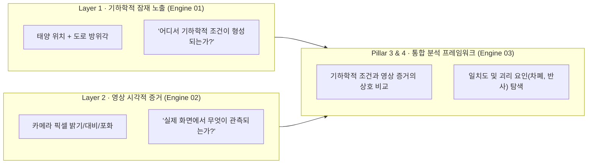

# SunSight 마스터 기술 해설 및 중간 종합 보고서
> **프로젝트 공식 명칭**: SunSight: 도심 도로 환경에서의 천문 기하학적 잠재 노출 스크리닝과 영상 기반 눈부심 시각적 증거 감지를 위한 프레임워크  
> **작성 일시**: 2026-11-03  
> **작성자**: 박범수 (AI Engineer, Team 「눈치」 Nunchi-ML)  

---

## Executive Summary (한 줄 요약)

> **"SunSight는 눈부심이라는 복합 현상을 하나의 숫자로 뭉뚱그려 예측하지 않고, '발생할 수 있는 물리적 조건(기하학)'과 '실제로 영상에서 관찰되는 시각적 증거(카메라)'로 역할을 분리하여 도심 도로의 눈부심 문제를 과학적·단계적으로 분석하는 시스템이다."**

---

## 1. 애초에 해결하려던 문제 (Problem Definition)

운전 중 태양빛으로 인한 눈부심(Glare)은 시야 장애를 일으키는 주요 위험 요인입니다. 그러나 **태양이 도로 정면에 비친다고 해서 운전자가 반드시 눈부심을 경험하는 것은 아닙니다.**

1. **도시 인프라 차폐**: 도로 방향이 태양과 일치해도 고층 빌딩, 가로수, 방음벽에 의해 태양이 가려질 수 있습니다.
2. **기상 요인**: 짙은 구름이나 안개로 인해 직사광이 산란·소멸할 수 있습니다.
3. **노면 및 반사광**: 태양이 전방 시야에 직접 들어오지 않더라도, 비 온 뒤 젖은 노면이나 선행 차량에 반사되어 눈부심 증거가 나타날 수 있습니다.
4. **기존 모델의 도메인 외삽 한계**: 고속도로 1km 단위 사고 데이터로 학습된 기존 모델을 도심 200m 세부 링크에 직접 적용하면 단위 왜곡(MAUP)과 교란 요인으로 인해 신뢰할 수 없는 결과가 도출됩니다.

따라서 SunSight는 **"미관측 사고 위험도를 억지로 외삽하는 방식"을 배제**하고, 두 가지 독립적인 축으로 문제를 분리하여 재정립하였습니다.

---

## 2. Layer 1 — 천문 기하학적 잠재 노출 계산기 (Engine 01)

### 2.1 개념 및 조작적 정의
Layer 1은 **태양의 3차원 위치와 도로의 진행 방향만을 비교하는 물리적 기하 계산기**입니다.

* **태양 고도각 조건**: $0^\circ < \theta_{\text{alt}} \le 25^\circ$ (운전자 눈높이를 직접 찌르는 저각도 태양)
* **방위각 원형 차이 조건**: $\Delta\phi_i(t) = \min(|\phi_{\text{sun}}(t) - \phi_i|, \ 360^\circ - |\phi_{\text{sun}}(t) - \phi_i|) \le 25^\circ$
* **청천 잠재 노출시간 (Clear-Sky Potential Exposure Hours)**:
  $$E_i = \sum_{t=1}^{T} \mathbb{I}_i(t) \cdot \Delta t \quad (T = 35,136 \text{ 시점, } \Delta t = 0.25\text{h})$$
  > **[중요]**: 이 시간은 실제 운전자가 눈부심을 경험한 시간이 아니라, 대기 차폐가 없다는 가정(Clear-Sky Assumption)하에 **"태양과 도로 방향이 기하학적으로 맞아떨어진 시간의 누적값"**입니다.

### 2.2 대구 달구벌대로 실측 분석 결과
* **분석 대상**: 대구 달구벌대로 164개 세부 링크 (32.81km, 다사역 ~ 사월역, 링크당 평균 연장 200.1m)
* **2024년 윤년 366일 전수 시뮬레이션 결과**:

| 주행 방향 | 연간 총 잠재 노출 범위 | 연간 링크 산술평균 | 집중 시간대 잠재 노출 최댓값 | 가용시간 대비 노출 비율 | 반대 시간대 잠재 노출 (기하 조건 하) |
| :--- | :---: | :---: | :---: | :---: | :---: |
| **Eastbound** (다사 $\rightarrow$ 사월) | $0.0\text{h} \sim 539.2\text{h}$ | **429.9h** | **최대 423.0h** (출근 07–09시) | **57.79%** ($423.0 / 732.0\text{h}$) | **0.0h** ($\Delta\phi > 25^\circ$) |
| **Westbound** (사월 $\rightarrow$ 다사) | $0.0\text{h} \sim 545.0\text{h}$ | **377.1h** | **최대 443.0h** (퇴근 17–19시) | **60.52%** ($443.0 / 732.0\text{h}$) | **0.0h** ($\Delta\phi > 25^\circ$) |

### 2.3 기하학적 민감도 및 공간 집중도 분석
1. **도로 방위각 오차 민감도 (Robustness)**:
   - OSM 도로 중심선 방위각 대비 평균 오차 2.43°, P90 오차 5.74° 발생.
   - 방위각 오차에도 불구하고 164개 링크 중 150개 링크(**91.5%**)의 Exposure Tier(상위 20% High / 중간 60% Med / 하위 20% Low)가 유지됨.
2. **균등 무작위 배치 귀무모형 대비 공간적 집중성 (Permutation Test)**:
   - 상위 20% High 구간(33개) 중 25개(75.8%)가 3대 주요 직선 축선(대실~계명대, 계명대~성서, 대구은행~범어)에 집중.
   - 10,000회 몬테카를로 순열검정 결과: $p_{\text{MC}} = \frac{0 + 1}{10,000 + 1} \approx 0.0001 \ (p < 0.001)$로, **균등 무작위 배치 귀무모형 대비 유의미한 공간적 연속성 확인**. (단, 도로 선형 자체의 공간 자기상관을 전부 보정한 것은 아님.)

---

## 3. Layer 2 — 차량 영상 기반 시각적 증거 감지기 (Engine 02)

### 3.1 개념 및 특징 추출
Layer 2는 차량 전면 카메라 영상에서 밝기, 포화, 대비 등 12개 컴퓨터 비전 특징을 추출하여 눈부심의 시각적 증거(Glare Evidence)를 탐지하는 모델입니다.

* **추출 특징**: `white_ratio`(포화 픽셀 비율), `bright_blob`(빛 번짐 덩어리), `road_contrast`(도로 대비), `road_sharp`(도로 윤곽 선명도), `sky_road_ratio`(역광 비율), `brightest_x/y/val`(최대 광원 위치/밝기) 등 12개.
* **학습 데이터**: 공개 주행 영상 벤치마크 (GLARE dataset, 130장 라벨링, 33개 영상 시퀀스 `vid0`~`vid32`).

### 3.2 영상 단위 GroupKFold 실측 평가 결과
비슷한 영상 프레임이 학습과 평가에 섞여 점수가 부풀려지는 것을 막기 위해 **영상 시퀀스(`vid`) 단위 GroupKFold(5-fold)**로 엄격히 검증한 실측치입니다:

| 모델 / 분류 방식 | 평가 조건 | 정확도 (Accuracy) | Macro F1 | 심한 눈부심 (Class 2) 재현율 |
| :--- | :---: | :---: | :---: | :---: |
| **단순 전체 밝기 규칙** | 단일 컷오프 | 0.40 | 0.33 | 0.04 |
| **하얀 픽셀 비율 규칙** | 단일 컷오프 | 0.26 | 0.25 | 0.19 |
| **LightGBM (3-class 다중 분류)** | GroupKFold 1회 | 0.48 | 0.44 | 0.22 |
| **LightGBM (3-class 다중 분류)** | **GroupKFold 30회 반복 평균** | - | **0.52 ± 0.05** | **0.32 ± 0.10** |
| **Stage 1 (Class 0 vs 1+2 이진 분류)** | 화각·기상 결합 테스트셋 | **0.84** | - | - |

> **[기술적 한계 및 정직한 평가]**:
> 1. 3개 클래스(정상/눈부심/심한 눈부심)를 직접 분류할 경우 GroupKFold Macro F1은 **0.52**, 심한 눈부심 재현율은 **0.32**에 머무릅니다.
> 2. 따라서 본 모델은 **실제 눈부심 발생을 완벽히 단정하는 '정답 판정기'가 아니며, 영상 내 고휘도 포화 현상을 감지하는 '시각적 증거의 대리 지표(Proxy Indicator)'**로 한정하여 사용합니다.
> 3. 이를 보완하기 위해 1단계(눈부심 유무, Acc 0.84)와 2단계(심각도 판별)로 계층화한 2-Stage 구조를 채택하였습니다.

---

## 4. 왜 둘을 분리했는가? (System Decoupling)

* **단일 블랙박스 AI의 위험성**: 영상만 보는 AI는 태양빛 때문인지, 앞차의 반사광 때문인지, 카메라의 노출 제어 실패 때문인지 원인을 분리할 수 없습니다.
* **기하 계산(Layer 1) 단독의 한계**: 빌딩 그늘이나 구름이 가리는 실제 환경을 알 수 없어 과다 오경보가 발생합니다.
* **분리의 본질**: **"수학적으로 확실한 물리적 사전 조건(Layer 1)"**과 **"불확실성이 큰 실시간 환경적 관측 증거(Layer 2)"**를 엄격히 분리하여, 서로를 검증하고 보완할 수 있는 분석 구조를 확립했습니다.

---

## 5. Pillar 3 & 4 — 두 엔진을 잇는 통합 분석 프레임워크 설계

### 5.1 4분면 일치성 분석표 (Concordance Matrix)
기하 조건 충족 여부($g \in \{0, 1\}$)와 영상 증거 검출 여부($v \in \{0, 1\}$)의 교차 분석을 통해 도로 환경의 물리적 특성을 탐색합니다:

| 구분 | 영상 증거 미관측 ($v=0$) | 영상 증거 관측 ($v=1$) |
| :---: | :--- | :--- |
| **기하 잠재 노출 충족 ($g=1$)** | **기하 노출 대비 증거 미관측** • 잠재적 설명 요인: 빌딩/수목 차폐, 구름/안개, 카메라 HDR | **기하 조건과 영상 증거 일치** • 기하 조건 하에서 시각적 증거 확인 |
| **기하 잠재 노출 미충족 ($g=0$)** | **기하 조건 외 증거 미관측** • 기하 조건 미충족 및 영상 증거 미포착 | **기하 조건 외 영상 증거** • 잠재적 설명 요인: 노면 거울반사, 선행차량 반사, 광축 편차 |

### 5.2 Geometric Exposure–Visual Evidence Rate Ratio (GE-VERR)
기하 노출 조건에 따른 영상 증거 관측률의 상대비(Relative Rate) 지표:

$$\text{GE-VERR} = \frac{\hat{P}(v=1 \mid g=1)}{\hat{P}(v=1 \mid g=0)}$$

* **통계적 해석**: 인과관계 지표가 아니며, "기하 조건 충족 시 영상 증거가 미충족 시 대비 몇 배 높은 비율로 관측되었는가"를 나타내는 상대 관측 비율입니다.
* **표본 보고 원칙**: 0-셀 발생 시 Haldane–Anscombe 연속성 수정($RR_{\text{adj}}$)을 보조적으로 검토하되, 관측 프레임 수($N_1, N_0$), 검출 건수($k_1, k_0$), 노출 세션 수($S_1, S_0$), 총 세션 수($S_{\text{total}}$), 증거 발생 세션 수($N_{\text{event session}}$)를 반드시 동시 공시합니다.

### 5.3 연관성 분석 모델의 위계 분리 (Model A vs Model B)
1. **[Model A] 마이크로 레벨: 순간 기하 노출 연관성**:
   $$\operatorname{logit}(P(v_{ijk}=1)) = \beta_0 + \beta_1 g_{ijk} + \boldsymbol{\gamma}^\top \mathbf{X}_{ijk} + u_i + b_j$$
   - 특정 순간의 기하 조건($g_{ijk}$)과 해당 프레임 증거 간의 **조건부 오즈비($e^{\beta_1}$)** 분석.
   - 세션 랜덤효과($b_j$) 및 세션 단위 블록 부트스트랩으로 프레임 간 자기상관 완화.
2. **[Model B] 매크로 레벨: 링크별 잠재 노출도 연관성**:
   $$\operatorname{logit}(P(v_{ijk}=1)) = \alpha_0 + \alpha_1 \tilde{E}_{i,h} + \boldsymbol{\gamma}^\top \mathbf{X}_{ijk} + b_j$$
   - 해당 시간대 링크 잠재 노출 비율($\tilde{E}_{i,h} = E_{i,h}/T_h$)이 높은 도로에서 관측률이 높은지 분석.
   - **한계**: 링크 고정효과 식별을 위해 링크 랜덤효과를 배제하므로, 도로 폭·주변 건물 등 링크 수준의 미관측 교란 요인이 통제되지 않는 한계를 명시.

---

## 6. 현재까지 확인된 기술적 상태 정의 (Current Status)

> **"SunSight는 도로의 청천 기하학적 잠재 노출을 산출하는 Layer 1 엔진과 공개 주행 영상 벤치마크 기반 눈부심 분류를 수행하는 Layer 2 엔진의 개별 구현 및 기초 검증을 진행하였으며, 두 엔진의 연계를 위한 통합 분석 프레임워크(Pillar 3·4)를 설계한 단계이다. 다만, 실차 주행 데이터 기반 통합 실증 검증은 아직 수행되지 않았으며, 영상 분류 성능과 링크 수준 교란 통제, 프레임 간 시계열 의존성 처리에는 추가적인 개선 및 검증이 필요하다."**

### 6.1 성과 위계 구분표

| 파이프라인 단계 | 상태 | 내용 |
| :--- | :---: | :--- |
| **Layer 1 (기하 엔진)** | **기초 구현 및 분석 완료** | 달구벌대로 164개 링크 2024년 잠재 노출 전수 산출, 민감도 분석(91.5%), 공간 집중성 순열검정($p_{\text{MC}} \approx 0.0001$) |
| **Layer 2 (비전 엔진)** | **초기 구현 및 검증 진행** | 공개 GLARE 벤치마크 기반 GroupKFold 평가 (Macro F1 0.52, Severe Recall 0.32), Stage 1 이진 분류 성능 평가 |
| **Pillar 3 (통합 연관성)** | **사전 분석 설계 수립** | GE-VERR 지표 정의, 6대 표본 프로파일 규격, Model A/B 혼합효과 모델 설계 |
| **Pillar 4 (괴리 분석)** | **사전 분석 설계 수립** | 기하 잠재 노출 대비 미관측/기하 외 증거에 대한 도심 차폐 및 노면 반사 잠재 설명 요인 평가 틀 수립 |
| **실차 통합 실증** | **미완료 (향후 과제)** | 대구 달구벌대로의 GPS·시간 동기화 실차 영상 데이터 확보 및 두 엔진 간 실제 연계 검증 |

---

## 7. 향후 추진 과제 (Next Steps)

1. **Layer 2 모델 신뢰도 및 임계값 재평가**:
   - 심한 눈부심(Severe Recall 0.32) 한계를 극복하기 위해 분류 임계값(Threshold) 조정 및 정답 판정기가 아닌 대리 지표로서의 적정 신뢰도 경계 설정.
2. **실차 데이터 인터페이스 연동 준비**:
   - 향후 달구벌대로 실차 주행 시 수집될 텔레매틱스(GPS, 타임스탬프, 차량 진행각, 카메라 프레임)와 Layer 1 링크 간 공간 조인 파이프라인 대기.
3. **Pillar 3 & 4 실증 실행**:
   - 실차 데이터 확보 시 GE-VERR 산출, Model A/B 추정, 4분면 괴리 패턴(도심 빌딩 차폐 구간 및 노면 반사 취약 구간) 실측 분석.
