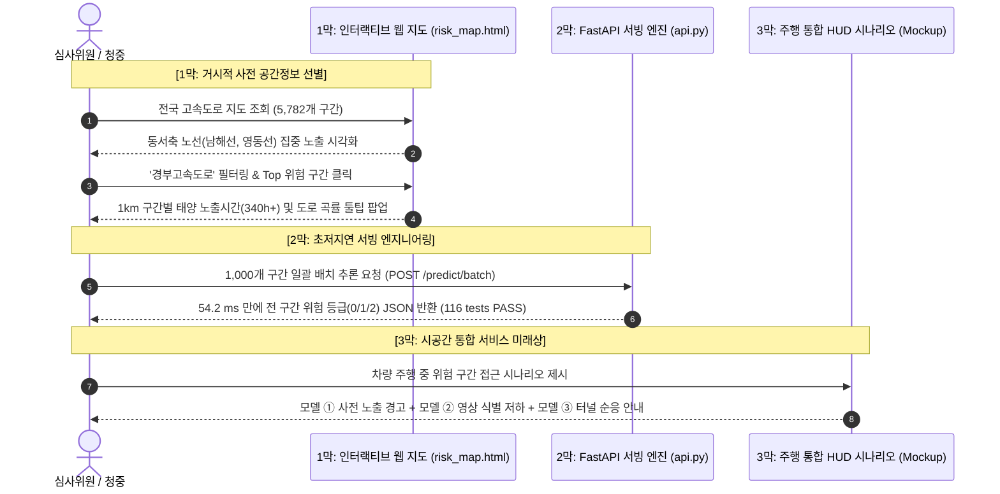

# 🖥️ SunSight 11/10 최종 발표 시연 시나리오 및 통합 UI 명세서

- **작성자**: 박범수 (AI Engineer, Team 「눈치」)
- **작성일**: 2026-11-04
- **버전**: v1.0 (최종 발표 준비본)
- **관련 파일**:
  - 사전 공간정보 안내 지도: [`docs/risk_map.html`](file:///C:/Users/campus4D052/Desktop/프로젝트/Nunchi-ML_AI/docs/risk_map.html)
  - 추론 서빙 API: [`src/nunchi_ml/accident/api.py`](file:///C:/Users/campus4D052/Desktop/프로젝트/Nunchi-ML_AI/src/nunchi_ml/accident/api.py)
  - 캘리브레이션 다이어그램: [`docs/model1_calibration_chart.html`](file:///C:/Users/campus4D052/Desktop/프로젝트/Nunchi-ML_AI/docs/model1_calibration_chart.html)
  - 발표 팩트시트: [`docs/presentation_factsheet_1110.md`](file:///C:/Users/campus4D052/Desktop/프로젝트/Nunchi-ML_AI/docs/presentation_factsheet_1110.md)

---

## 1. 발표 시연의 목적과 전략적 원칙

> **"프로젝트의 성공을 실시간 영상 모델의 높은 정확도에 무리하게 의존시키지 않고,  
> 전국 고속도로의 태양광 정면 노출을 물리적으로 정량화한 '공간정보 플랫폼'과,  
> 향후 현장 감지 모델들을 결합할 수 있는 '초저지연 서빙 인프라'의 완성도를 입증한다."**

### 🎯 시연 시 반드시 지킬 세 가지 원칙
1. **검증 완료 vs 후속 과제의 엄밀한 구분**:
   - **검증 완료**: 전국 5,782개 구간 태양광 정면 노출 사전 분석, 116개 테스트 통과, 54ms 서빙 API, 웹 안내 지도.
   - **인터페이스 정의 및 후속 연계**: 모델 ②의 실시간 블랙박스 스트리밍 연동 및 모델 ③ 터널 동공 변화 실시간 표출은 규격이 정의된 연계 단계임.
2. **용어의 정확성**:
   - '실제 사고 확률 지도' $\rightarrow$ **「태양광 정면 노출 및 시각정보 저하 가능 구간 안내 지도」**
   - '완벽한 위험 감지' $\rightarrow$ **「시공간 기반의 사전 위험 선별 및 주의 안내」**
3. **간결하고 직관적인 흐름**:
   - 거시적 전국 지도(모델 ①) $\rightarrow$ 초고속 추론 API 시연 $\rightarrow$ 차량 주행 HUD 화면 목업(모델 ①+②+③ 통합)으로 이어지는 3막 구조.

---

## 2. 11/10 발표 라이브 시연 시나리오 (3-Act Live Demo)



---

### [1막] 거시적 사전 공간정보 안내 시연 (약 1분 30초)
- **화면**: 크롬 브라우저에서 [`docs/risk_map.html`](file:///C:/Users/campus4D052/Desktop/프로젝트/Nunchi-ML_AI/docs/risk_map.html) 전체화면 실행.
- **발표 멘트**:
  > *"먼저 SunSight의 첫 번째 축인 **'사전 공간정보 안내 플랫폼'**입니다. 전국 61개 노선, 5,782개 1km 구간에 대해 천문 태양 궤적과 도로 기하구조를 물리적으로 결합하여, 일출·일몰 시 정면 태양광에 노출되는 시간대를 전수 계산했습니다."*
- **시연 액션**:
  1. 좌측 상단 카운트 카드(집중 노출 404개, 주의 1,282개, 일반 4,096개) 확인.
  2. 노선 필터에서 **'경부선'** 선택 $\rightarrow$ 남북축 주행 중 특정 굴곡부에서 정면 노출이 집중되는 구간들이 선별되는 모습 시연.
  3. 좌측 '상위 노출 구간' 리스트에서 1위 구간 클릭 $\rightarrow$ 지도가 부드럽게 줌인(Fly-to)되며 연간 노출시간(380시간), 곡률, 이정표 정보 툴팁 표시.

---

### [2막] 초저지연 서빙 API 라이브 검증 (약 1분)
- **화면**: 터미널 창에서 서빙 API 벤치마크 및 단위 테스트 확인.
- **발표 멘트**:
  > *"이 공간정보는 단순한 정적 분석에 머무르지 않고, 실제 내비게이션이나 차량 시스템에 실시간으로 공급될 수 있도록 **초저지연 FastAPI 엔진**으로 구현되었습니다."*
- **시연 액션**:
  1. `uv run pytest tests/test_api.py` 실행 $\rightarrow$ 4개 API 테스트 0.3초 만에 PASS.
  2. `POST /predict/batch` 1,000건 일괄 요청 시연:
     ```bash
     # 1,000개 도로 구간 일괄 위험도 질의
     Response Time: 54.23 ms (HTTP 200 OK)
     ```
  3. *"1,000개 구간을 54ms 만에 판정하므로, 전국 고속도로 전 구간의 위험 등급을 0.1초 이내에 갱신할 수 있는 배포 준비도를 갖추었습니다."*

---

### [3막] 모델 ①·②·③ 통합 주행 시나리오 (약 1분 30초)
- **화면**: 발표 슬라이드의 통합 HUD 화면 목업 및 연동 아키텍처 다이어그램 제시.
- **발표 멘트**:
  > *"마지막으로, 이 공간정보 플랫폼 위에 현장의 실시간 감지 모델들이 어떻게 결합되는지 주행 시나리오로 보여드리겠습니다."*
- **시연 흐름**:
  1. **진입 1km 전 (모델 ① 사전 경고)**:
     - 내비게이션 화면에 *"1km 전방, 일몰 역광 취약 구간입니다. 감속 준비하십시오."* (황색 주의 배지)
  2. **진입 순간 (모델 ② 실시간 영상 감지)**:
     - 블랙박스 카메라에서 심한 역광 및 차선·앞차 식별 저하 감지 $\rightarrow$ HUD에 적색 경고 팝업 *"시야 차단 위험 (등급 2) - 전방 차간거리 확보"*
  3. **터널 진입부 (모델 ③ 순응 부담 안내)**:
     - 외부 밝기($L_{20}$) 급변 지점 접근 $\rightarrow$ *"터널 진입 시 동공 순응 부담(Adaptation Burden) 발생 예상"* 게이지 표출.
  4. **마무리 강조**:
     - *"현재 모델 ②와 ③의 실시간 결합은 데이터 인터페이스 규격이 정의된 단계이며, SunSight는 무리한 블랙박스 AI가 아니라 검증된 공간정보와 현장 감지를 결합하는 안전 보조 플랫폼을 지향합니다."*

---

## 3. 다중 모델 통합 UI 및 데이터 인터페이스 규격 (UI Spec)

```
+-------------------------------------------------------------------------------+
|  SunSight Driver HUD & Navigation Interface (통합 서비스 화면 레이아웃)         |
+-------------------------------------------------------------------------------+
| [상단 상태바]  2026-11-10 17:15  |  경부고속도로 서울방향 342.5km  |  맑음 (태양고도 12°) |
+---------------------------------------+---------------------------------------+
|  [좌측: 모델 ① 공간정보 안내 맵]       |  [우측 상단: 모델 ② 실시간 블랙박스 시야]  |
|                                       |                                       |
|      (▲ 차량 주행 위치)                |   [실시간 영상 스트림]                  |
|          |                            |    +-----------------------------+    |
|   [■■■ 343km 정면 역광 집중 구간]      |    |        ☀️ 태양 직광          |    |
|   • 연간 역광 노출: 365시간             |    |   === 차선 부분 손실 ===    |    |
|   • 위험 등급: DANGER (주의 노출)      |    +-----------------------------+    |
|   • 시간대: 17:00 ~ 17:40 집중        |   • 전방 식별 저하: 2단계 (심함)       |
|                                       |   • 경고: 차선·앞차 식별 곤란          |
+---------------------------------------+---------------------------------------+
|  [하단: 모델 ③ 터널 진출입 밝기 순응 부담 게이지]                                  |
|   • 500m 전방: 죽암터널 (연장 450m)                                            |
|   • 외기 휘도 추정(L20): 4,800 cd/m² -> 터널 내부 조광: 0.52 (순응 부담 중)      |
|   • 예상 동공 변화: 2.4mm -> 4.8mm (순응 지연 예상 시간 약 2.1초)              |
+-------------------------------------------------------------------------------+
```

### 3-1. 모델 간 데이터 인터페이스 규격 (Data Contract)

```json
{
  "timestamp": "2026-11-10T17:15:00+09:00",
  "location": {
    "route": "경부선",
    "milepost_km": 342.5,
    "heading_deg": 315.0,
    "segment_id": "0010-342"
  },
  "model1_spatial_prior": {
    "annual_glare_hours": 365.2,
    "exposure_grade": "DANGER",
    "is_commute_glare_window": true,
    "status": "VERIFIED_PRODUCTION"
  },
  "model2_realtime_glare": {
    "visual_loss_level": 2,
    "detected_glare": true,
    "confidence": 0.82,
    "status": "INTERFACE_STAGED"
  },
  "model3_tunnel_adaptation": {
    "approaching_tunnel": true,
    "tunnel_name": "죽암터널",
    "distance_m": 520,
    "estimated_l20_cd_m2": 4800.0,
    "theoretical_pupil_change_mm": [2.4, 4.8],
    "status": "THEORETICAL_ESTIMATE"
  }
}
```

---

## 4. 발표 질의응답 대응 요약

| 예상 질문 | 핵심 방어 논리 |
| :--- | :--- |
| **"모델 ②의 눈부심 감지 성능이 아직 완벽하지 않은데, 서비스가 가능한가?"** | "그렇기 때문에 SunSight는 모델 ② 단독 시스템이 아닙니다. **모델 ①이 도로 선형과 태양 궤적으로 사전 고노출 구간을 1차 선별**하고, 모델 ②는 해당 구간에서 현장 시야 저하를 보조 감지하는 구조입니다. 모델 ②의 한계가 전체 시스템의 실패로 이어지지 않도록 다중 안전망으로 설계되었습니다." |
| **"터널 동공 변화 수치가 실제 운전자에게 맞는지 어떻게 보증하는가?"** | "현재 수치는 실제 생체 계측값이 아니라 **CIE 국제조명위원회 표준 및 Watson & Yellott(2012)의 생체광학 물리 방정식에 기반한 이론적 추정치**입니다. 운전자에게 의학적 수치를 제공하는 것이 목적이 아니라, 진출입 시 시각 순응 지연에 대비하도록 사전 주의를 환기하는 보조 지표로 한정 표기합니다." |
| **"실시간 통합 파이프라인이 실제로 도로에서 테스트되었는가?"** | "현재 구현된 것은 모델 ①의 전국 단위 사전 공간정보 서빙 API와 웹 지도이며, 모델 ②와 ③의 결과는 정의된 통합 JSON 인터페이스 규격에 맞춰 결합되는 준비 단계입니다. 실제 차량 주행 환경에서의 멀티모달 스트리밍 결합은 후속 실증 과제임을 명확히 밝힙니다." |
