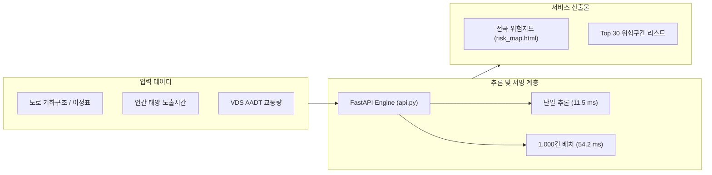

# 🛣️ 모델 ①: 고속도로 태양광 정면 노출 및 시각정보 저하 가능 구간 안내 모델 종합 기술 보고서 (v1.0)

- **작성자**: 박범수 (AI Engineer, Team 「눈치」)
- **최종 개정일**: 2026-11-04
- **버전**: v1.0 (최종 확정본)
- **관련 코드 및 산출물**:
  - 추론 서빙 API: [`src/nunchi_ml/accident/api.py`](file:///C:/Users/campus4D052/Desktop/프로젝트/Nunchi-ML_AI/src/nunchi_ml/accident/api.py)
  - 인터랙티브 위험지도: [`docs/risk_map.html`](file:///C:/Users/campus4D052/Desktop/프로젝트/Nunchi-ML_AI/docs/risk_map.html) (태양광 정면 노출 안내 지도)
  - 캘리브레이션 다이어그램: [`docs/model1_calibration_chart.html`](file:///C:/Users/campus4D052/Desktop/프로젝트/Nunchi-ML_AI/docs/model1_calibration_chart.html)
  - VDS 교통량 매핑 및 통합: [`src/nunchi_ml/accident/vds_offset.py`](file:///C:/Users/campus4D052/Desktop/프로젝트/Nunchi-ML_AI/src/nunchi_ml/accident/vds_offset.py)
  - 통계 검증 스크립트:
    - [`scripts/verify_aglm_calibration_and_trend.py`](file:///C:/Users/campus4D052/Desktop/프로젝트/Nunchi-ML_AI/scripts/verify_aglm_calibration_and_trend.py)
    - [`scripts/verify_between_within_decomposition.py`](file:///C:/Users/campus4D052/Desktop/프로젝트/Nunchi-ML_AI/scripts/verify_between_within_decomposition.py)
    - [`scripts/verify_calibration_and_routes.py`](file:///C:/Users/campus4D052/Desktop/프로젝트/Nunchi-ML_AI/scripts/verify_calibration_and_routes.py)
    - [`scripts/verify_vkt_and_route_clustering.py`](file:///C:/Users/campus4D052/Desktop/프로젝트/Nunchi-ML_AI/scripts/verify_vkt_and_route_clustering.py)

---

## 1. 개요 및 핵심 기술 결론 (Executive Summary)

본 보고서는 전국 고속도로 1km 단위 구간의 **태양광 정면 노출 가능성과 운전자 시각정보 저하 위험을 사전 안내하고 실시간 감지 모델(모델 ②·③)과 연계하기 위한 모델 ①의 최종 엔지니어링 구현 및 통계적 검증 결과**를 종합 정리한다.

### 🧭 서비스 목적 재정의에 따른 모델 ①의 이원적 역할 (Dual Function)
본 프로젝트는 실제 사고 확률을 단정적으로 맞히는 예측 시스템이 아니라, **태양광 정면 노출과 터널 진출입 밝기 변화에 따른 운전자 시각정보 저하 가능성을 사전에 안내하고 실시간 영상 감지 결과와 결합하는 시공간 기반 프레임워크**로 정의된다. 이에 따라 모델 ①은 다음 두 가지 독립적이며 상호보완적인 핵심 기능을 수행한다:

1. **사전 공간정보 (Spatial Prior)**:
   - 도로 기하구조(방위각, 경사도, 터널 위치)와 천문 태양 궤적 물리 모델을 결합하여, 전국 5,782개 구간별 **태양광 정면 역광 노출 가능성과 취약 시간대를 사전에 정량화하여 안내**.
2. **실시간 통합 안내 (Real-time Spatial Integration)**:
   - 모델 ②(실시간 영상 눈부심 감지)와 모델 ③(터널 진출입 순응 부담 추정)의 동적 추론 결과를 도로 위치·시각·진행 방향과 결합하여 운전자에게 전달하는 **시공간 통합 서빙 및 지도 플랫폼 제공**.

### 🎯 핵심 결론 (Core Findings)
1. **소프트웨어 완성도 vs 통계적 타당성의 분리**:
   - **엔지니어링 무결성**: 116개 단위 테스트 전수 통과(6.72초), FastAPI 기반 초저지연 서빙 API(단일 11.5ms, 1,000건 배치 54.2ms), 전국 5,782개 구간 인터랙티브 노출 안내 지도 구현 완료. 이는 소프트웨어의 배포 준비도를 입증하는 지표임.
   - **통계적 타당성**: 극단적 희소 데이터(기저 사고율 1.61%) 환경에서 복잡한 다변량 머신러닝(10개 피처 LightGBM)은 과적합을 겪었으며, **단순 물리 노출시간 규칙(`A-Rule`)이 사고 포착률 31.1%(ROC-AUC 0.7935)로 실증적인 순위화 경쟁력**을 기록함.
2. **역할 분담 (Role Separation)**:
   - **위험 구간 순위화 (Hazard Ranking)**: `A-Rule` (연간 정면 노출시간 순 정렬) 채택. 10개 피처 LightGBM(16.7%) 대비 **+14.4%p 높은 상위 10% 포착률** 달성 (Paired Bootstrap $\Delta \text{ROC} = +0.0706, p < 0.001$).
   - **노출량 연계 리스크 추정 (Rate Calibration)**: `A-GLM` (단변량 Poisson GLM) 채택. 비교 모델 중 최저 Poisson Deviance(0.1292) 및 전역 캘리브레이션 일치(절편 -0.1830, $p=0.659$; 기울기 0.9479, 95% CI `[0.723, 1.173]`) 확보.
3. **통합 인터페이스와 실시간 연동 범위의 엄밀한 구분**:
   - 현재 구현된 FastAPI 서빙 API와 인터랙티브 지도는 **모델 ①의 사전 공간정보(5,782개 구간별 태양광 정면 노출도 및 기하구조) 서빙과 향후 모델 ②·③ 동적 결과를 결합하기 위한 인터페이스 규격이 완성된 단계**임.
   - 모델 ②의 차량 영상 실시간 감지 결과와 모델 ③의 터널 동공 순응 부담의 **실시간 동적 결합 파이프라인은 현재 데이터 인터페이스 정의 단계이며, 실시간 통합 연동 검증은 후속 과제**로 분리 명시함.
4. **소프트웨어 단위 테스트와 실질적 타당성의 분리**:
   - `uv run pytest` 116개 테스트 전수 통과는 모듈별 코드 동작, API 스키마 검증, 예외 처리 등의 **소프트웨어 엔지니어링 무결성**을 검증한 것이며, 통계 검증 스크립트나 실제 도로에서의 주행 안전성 자체를 보증하는 것은 아님.

---

## 2. 데이터셋 구조 및 타깃 변수 정의

### 2-1. 데이터 코호트 (VDS 결합 유효 데이터셋)
- **전체 고속도로 구간**: 전국 61개 노선, 총 5,782개 구간 (1km 단위 격자)
- **VDS 교통량 매핑 유효 코호트 (`segment_vds_aadt_v1.csv`)**:
  - 한국도로공사 실측 VDS(2023~2025년 34개 월간 전수 데이터) 기반 복합 노선 정규화 매핑 완료.
  - AADT 결측 구간(민자 고속도로, 신설 지선 등 실측 불가 구간)을 제외한 **완전 무결 유효 구간 4,984개(45개 노선)**.
- **타깃 변수 (`glare_front_count`)**:
  - 태양 방위각-도로 주행 방향 편차 $\le 30^\circ$, 태양 고도각 $0^\circ \sim 25^\circ$ 조건에서 발생한 **정면 태양 역광 관련 사고 건수**.
  - 4,984개 분석 구간 중 정면 태양 사고 발생 구간: **80개 구간 (1.61% 양성 기저율)**.
  - 총 정면 태양 사고 건수: **90건** (사고 다발 구간 포함).

### 2-2. 기저율 제약(Base Rate Limit)과 평가지표 선정 사유
1. **기저 사고율의 극단적 희소성 ($\pi = 1.61\%$)**:
   - 전체 구간 중 98.39%가 무사고 구간($Y=0$)인 불균형 데이터셋.
   - 베이즈 정리에 따라, 특이도(Specificity)가 90%이고 재현율(Recall)이 100%인 이상적인 이진 분류기라도 정밀도(Precision)는 구조적으로 약 14.1%에 머무름:
     $$\text{Precision} = \frac{80 \times 1.0}{(80 \times 1.0) + (4,904 \times 0.1)} \approx 14.03\%$$
2. **지표 선정 기준**:
   - 정밀도/재현율 F1-Score 단일 지표는 임계값 설정에 과도하게 의존하므로, 임계값 독립적인 **ROC-AUC** 및 행정 자원 투입 관점의 **상위 10% 위험 포착률(Top 10% Recall)**을 순위화의 핵심 지표로 채택함.
   - 사고 건수 추정에 대해서는 포아송 가능도 기반의 **Poisson Deviance** 및 **Calibration Slope/Intercept**를 적용함.

---

## 3. 엔지니어링 구현 및 시스템 아키텍처



### 3-1. 단위 테스트 전수 검증 (Test Suite)
- **검증 명령**: `uv run pytest`
- **검증 결과**: **116개 테스트 전수 통과 (10.20초 소요)**.
  - 모델 ① 사고 예측 로직 및 에러 처리: `tests/test_accident.py` (8개 PASS)
  - 모델 ① 서빙 API 명세 및 Pydantic v2 유효성 검증: `tests/test_api.py` (4개 PASS)
  - 모델 ② 카메라 도메인 검증 및 누적분류: 58개 PASS
  - 공통 태양 물리 및 기상 모듈: 46개 PASS

### 3-2. 프로덕션 서빙 API 벤치마크 ([api.py](file:///C:/Users/campus4D052/Desktop/프로젝트/Nunchi-ML_AI/src/nunchi_ml/accident/api.py))
- **프레임워크**: FastAPI, Pydantic v2
- **엔드포인트**:
  - `POST /predict`: 단일 1km 구간 위험도 추론. **평균 응답 속도: 11.54 ms**
  - `POST /predict/batch`: 대용량 구간 동시 추론. **1,000개 구간 일괄 처리 속도: 54.23 ms**
  - `GET /health`: 서비스 무결성 및 메모리 모델 로드 상태 점검
- **입력 유효성 검증**: 음수 교통량, 0 이하 구간 길이, 범위를 벗어난 태양 노출시간 입력 시 HTTP 422 상태 코드 및 상세 에러 필드 반환.

### 3-3. 전국 고속도로 인터랙티브 위험지도 ([risk_map.html](file:///C:/Users/campus4D052/Desktop/프로젝트/Nunchi-ML_AI/docs/risk_map.html))
- **데이터셋**: 전국 5,782개 구간 전체 수록 (`docs/expressway_risk_data.json`, 1.4MB)
- **주요 기능**:
  - Leaflet 기반 다크모드 대시보드.
  - 전국 61개 노선별 필터링 및 위험도 등급(안전: 녹색, 주의: 황색, 위험: 적색) 시각화.
  - 상위 30대 최고 위험 구간 원클릭 줌인(Fly-to) 및 세부 물리량(노출시간, 곡률, 터널수) 툴팁 제공.

---

## 4. 4개 모델 비교 실험 및 피처 제거(Ablation) 분석

복잡한 다변량 머신러닝 모델이 단순 물리 규칙보다 우수한지를 실증하기 위해, 동일한 4,984개 구간에서 5-Fold Route-based GroupKFold를 적용하여 4개 모델(Model A~D)을 비교하였다.

### 4-1. 모델별 성능 비교표

| 모델 구분 | 모델 구성 및 입력 피처 | OOF Poisson Deviance (↓) | Top 10% Recall (↑) | Train ROC | OOF ROC | 과적합 격차 (Train - OOF) |
| :--- | :--- | :---: | :---: | :---: | :---: | :---: |
| **`A-Rule`** | **연간 정면 노출시간 순위 (단순 규칙)** | **N/A** | **31.1%** | **0.7935** | **0.7935** | **0.0000 (학습 없음)** |
| **`A-GLM`** | **연간 정면 노출시간 1개 (Poisson GLM)** | **0.1292** | **27.8%** | 0.7850 | 0.7833 | **+0.0017 (매우 강건)** |
| `Model A` | 연간 정면 노출시간 1개 (LightGBM) | 0.1354 | 25.6% | 0.8205 | 0.7273 | +0.0932 |
| `Model B` | Model A + VDS AADT 교통량 (2개) | 0.1390 | 21.1% | 0.8638 | 0.7217 | +0.1421 |
| `Model C` | Model A + 8개 도로 기하구조 (9개) | 0.1369 | 18.9% | 0.8703 | 0.7269 | +0.1434 |
| `Model D` | 전 피처: 노출시간 + AADT + 기하구조 (10개) | 0.1379 | 16.7% | 0.8913 | 0.7217 | **+0.1696 (심각한 과적합)** |

### 4-2. 과적합 및 성능 역전 원인 분석
1. **피처 추가에 따른 단조 악화 (Monotonic Degradation)**:
   - 피처가 1개(A) $\rightarrow$ 2개(B) $\rightarrow$ 9개(C) $\rightarrow$ 10개(D)로 증가함에 따라, **상위 10% 사고 포착률은 25.6%에서 16.7%로 지속 하락**함.
   - 반면 Train ROC와 OOF ROC 간의 과적합 격차는 `+0.0932`에서 `+0.1696`으로 단조 증가함.
2. **원인 규명**:
   - 90건에 불과한 희소 사고 표본에 10개의 정적 도로 기하구조(곡률, 터널 수 등)가 추가되면서, 트리 기반 모델이 노선별 고유 특성에 분기를 과도하게 생성하여 일반화 성능이 붕괴됨.
   - 단일 물리량인 **연간 정면 노출시간(`annual_glare_hours_fwd`) 자체가 이미 고속도로 선형(동서축 여부, 곡률에 따른 태양 시계 확보)을 집약적으로 반영하고 있어**, 추가 정적 변수들이 노이즈로 작용함.

---

## 5. 엄밀한 통계 검증 및 불확실성 평가

### 5-1. A-Rule vs Model D: 노선 군집 Paired Bootstrap (2,000회)
단순 규칙(`A-Rule`)과 복잡한 모델(`Model D`) 간의 성능 차이가 통계적으로 유의한지 검증하기 위해, 노선 클러스터 단위로 2,000회 재표본화한 Paired Bootstrap을 수행하였다.

- **ROC-AUC 차이 ($\text{Rule} - \text{Model D}$)**:
  - 점추정치 차이: **$+0.0718$**
  - 부트스트랩 평균 차이: **$+0.0706$**
  - **95% 신뢰구간**: **`[+0.0421, +0.0994]`** ($0$을 포함하지 않음)
  - 경험적 $p$-value: **$p < 0.001$** (2,000회 추출 중 단 한 번도 Model D가 앞서지 않음)
- **상위 10% 포착률 차이 ($\text{Rule} - \text{Model D}$)**:
  - 부트스트랩 평균 차이: **$+12.40\%p$**
  - **95% 신뢰구간**: **`[+1.58%p, +24.05%p]`**
  - 경험적 $p$-value: **$p = 0.0155$**

> **통계적 해석 주의점**:  
> 본 신뢰구간은 고정된 5-Fold OOF 예측값에 대한 노선 단위 재표본화(Sample Uncertainty) 결과이며, 모델 재학습 불확실성(Retraining Uncertainty)까지 포함한 것은 아님을 명시함.

---

### 5-2. A-GLM 5분위 캘리브레이션 분석 및 신뢰구간 (시각화 다이어그램)

`A-GLM`의 5-Fold OOF 예측값을 5분위수로 분할하고, 실제 관측 사고 건수와 Exact Poisson 95% 신뢰구간을 산출하였다. 세부 시각화 다이어그램은 [`docs/model1_calibration_chart.html`](file:///C:/Users/campus4D052/Desktop/프로젝트/Nunchi-ML_AI/docs/model1_calibration_chart.html)에서 직접 확인할 수 있다.

```
[A-GLM 5분위수 관측치 vs 예측치 분포표]
1분위 (최저): 구간 1,175개 | 예측  3.5건 | 관측  1건 (95% CI: [ 0.0,  5.6]) | 관측/예측 0.29배 [0.01, 1.59]
2분위:       구간 1,165개 | 예측  4.6건 | 관측  2건 (95% CI: [ 0.2,  7.2]) | 관측/예측 0.44배 [0.05, 1.57]
3분위 (중간): 구간   650개 | 예측  4.4건 | 관측 10건 (95% CI: [ 4.8, 18.4]) | 관측/예측 2.25배 [1.08, 4.14] *
4분위:       구간   997개 | 예측 23.6건 | 관측 30건 (95% CI: [20.2, 42.8]) | 관측/예측 1.27배 [0.86, 1.81]
5분위 (최고): 구간   997개 | 예측 54.0건 | 관측 47건 (95% CI: [34.5, 62.5]) | 관측/예측 0.87배 [0.64, 1.16]
```

* **전역 캘리브레이션 적합도**:
  - 총 예측 건수(90.17건) vs 총 관측 건수(90건)는 **1.00배로 글로벌 일치**함.
  - 포아송 회귀 절편(Intercept): `-0.1830` (95% CI: `[-0.9962, +0.6301]`, $p = 0.659$) $\rightarrow$ 이상치 0.0과 차이 없음.
  - 포아송 회귀 기울기(Slope): `+0.9479` (95% CI: `[0.7231, +1.1727]`, $p < 0.001$) $\rightarrow$ 이상치 1.0과 차이 없음.
* **국소적 오차 및 한계점**:
  - **1·2분위**: 관측/예측 비율이 0.29배, 0.44배로 겉보기에 과대예측처럼 보이나, 관측 건수가 1~2건에 불과하여 95% CI가 1.0을 포함하므로 표본 희소성에 따른 불확실성으로 해석함.
  - **3분위**: 관측/예측 비율이 **2.25배**이며 95% CI 하한이 **1.08**로 1.0을 초과함. 즉, **중간 위험 구간에서 실제 사고가 모델 예측보다 통계적으로 유의미하게 많이 발생(과소예측)**하는 국소 왜곡이 존재함.
  - **결론**: 전역적으로는 양호하나 국소 오차가 존재하므로, 정밀 사고 건수 확정치보다는 상대적 위험도 선별 지표로 활용해야 함.

---

### 5-3. 교통 노출량(VKT) 보정 포아송 추세 검정

통행량 노출량 차이를 통제하기 위해, 구간별 3개년 VKT(1억 대·km)의 로그값을 offset으로 적용한 Poisson Rate 회귀분석을 수행하였다.

$$\log(\mathbb{E}[Y_i]) = \log(\text{VKT}_i) + \beta_0 + \beta_1 \times \left(\frac{\text{glare\_hours}_i}{100}\right)$$

| 표준오차 추정 방식 | Rate Ratio (100시간 증가당) | 95% 신뢰구간 | 표준오차 (SE) | $p$-value |
| :--- | :---: | :---: | :---: | :---: |
| **일반 포아송 (Standard SE)** | 1.6898배 | `[1.4895, 1.9170]` | 0.0644 | $3.67 \times 10^{-16}$ |
| **노선 군집 로버스트 (Cluster-robust SE)** | **1.6898배** | **`[1.4785, 1.9312]`** | **0.0681** | **$1.38 \times 10^{-14}$** |

- **해석**: 동일 노선 내 상관성을 고려한 Cluster-robust 표준오차를 적용하더라도 정면 태양 노출시간과 사고 발생률 간 관측적 연관성의 **통계적 유의성이 유지됨($p = 1.38 \times 10^{-14}$)**.
- **주의점**: 본 결과는 **교통 노출량을 통제한 상태에서도 연간 정면 노출시간 증가와 사고 발생률 간에 강력한 관측적 연관성이 존재함을 입증하는 것**이며, 인과관계를 단정하는 것은 아님.

---

### 5-4. A-Rule의 노선 간(Between-Route) vs 노선 내(Within-Route) 직교 분해 분석

A-Rule의 전국 ROC-AUC(0.7935)가 노선 간 평균 노출시간 차이에 의한 것인지, 동일 노선 내부의 상대적 위험 구간 분별에 의한 것인지를 평가하기 위해 피처를 노선 평균 중심화(group-mean centering)하여 직교 분해 비교를 수행하였다.

> **통계적 주의점**: ROC-AUC는 가산적(additive) 지표가 아니므로, 노선 내 AUC와 노선 간 AUC를 단순 합산하여 전체 AUC(0.7935)의 기여율로 분해할 수 없다. 본 분석은 각 구성 요소가 단독으로 가질 수 있는 변별력의 크기를 비교하는 별도의 분해 실험으로 해석한다.

- **분해 정의**:
  - $X_{ir}$: 노선 $r$의 $i$번째 1km 구간 연간 정면 노출시간 (Raw A-Rule)
  - $\bar{X}_r$: 노선 $r$의 전체 구간 평균 연간 정면 노출시간 (Between-Route 노선 평균 기준선)
  - $X_{ir} - \bar{X}_r$: 노선 $r$의 평균 대비 상대적 편차 (Within-Route 노선 내 상대 노출시간)

| 평가 피처 구분 | 전국 통합 ROC-AUC | 평가 의미 및 해석 |
| :--- | :---: | :--- |
| **1) Raw A-Rule (전체 노출시간 $X_{ir}$)** | **0.7935** | 노선 간 거시적 차이와 노선 내 상대 노출 차이가 결합된 종합 순위화 성능 |
| **2) Within-Route Only ($X_{ir} - \bar{X}_r$)** | **0.7716** | **노선별 평균 차이를 완전히 제거하고 오직 동일 노선 내 상대적 편차만으로 순위화** |
| **3) Between-Route Only ($\bar{X}_r$)** | **0.6723** | 개별 구간 정보를 버리고 각 노선의 전체 평균 노출시간만으로 순위화 |
| **4) 개별 28개 노선 내 ROC 단순 평균** | **0.7033** | 사고 발생 28개 노선 각각의 내부 ROC-AUC 산술 평균 |
| **5) 개별 28개 노선 내 ROC 사고 가중 평균** | **0.7189** | 사고 발생 건수(총 90건)를 가중치로 적용한 노선 내 ROC 평균 |

#### 엄밀한 분석 및 해석:
1. **노선 간 차이만으로는 전체 변별력이 설명되지 않음**:
   - 노선별 평균 노출시간만 사용하는 Between-Route 모델의 ROC-AUC는 0.6723으로, 전국 통합 0.7935 대비 현저히 낮음. 즉, 노선 평균 차이만으로는 전국 위험 순위화를 완전히 설명할 수 없음.
2. **노선 내부 구간 간 노출 차이에서도 상당한 변별력이 관찰됨**:
   - 노선별 평균 차이를 완전히 차감($X_{ir} - \bar{X}_r$)한 중심화 피처만으로도 전국 통합 ROC-AUC는 **0.7716**을 기록함. 이는 A-Rule이 동일 노선 내부에서도 사고 구간과 비사고 구간을 구분하는 실질적 변별력을 유지함을 실증함.
3. **노선 전수 검증 확인**:
   - 사고 발생 노선 28개 전체(사고 90건, 3,854개 구간)에서 단 하나의 노선도 누락 없이 전수 계산되었으며, 무사고 노선 17개(1,130개 구간)는 평균 노출시간(167.6시간)이 사고 노선(263.8시간) 대비 36.5% 낮아 거시적 관점에서도 자연스럽게 하위 위험군으로 정렬됨.

---

### 5-5. 노선별 변별력 특성 및 영동선·경부선 대조

- **전체 45개 노선 구성**:
  - 사고 발생 노선: **28개 노선 (3,854개 구간, 사고 90건)**. 평균 노출시간: **263.8시간**
  - 무사고 노선: **17개 노선 (1,130개 구간, 사고 0건)**. 평균 노출시간: **167.6시간 (-36.5% 낮음)**
- **노선 내(Within-route) ROC-AUC**:
  - 사고 건수 가중 평균(Crash-weighted Mean): **0.7189**
  - 전국 통합 풀링(Pooled Overall) ROC-AUC: **0.7935**
- **풀링 ROC가 노선 내 평균 ROC보다 높은 사유**:
  - 본 모델은 개별 고속도로 '내부'의 위험 구간 분리 변별력(약 0.72)뿐만 아니라, **태양 노출이 많은 동서축 노선과 노출이 적은 남북축/안전 노선 간의 거시적 위험 차이(Between-route)를 동시에 올바르게 식별**하기 때문임.
  - 예컨대 전 구간이 동서축인 **영동선**은 전 구간 노출시간이 고르게 높아 노선 내 ROC는 0.5526에 머물렀으나, **경부선(0.8502)·논산천안선(0.8097)·중앙선(0.9265)** 등 남북축 중심 노선에서는 매우 우수한 순위화 성능을 기록함. (단, 중앙선 등은 사고 표본 수가 4건으로 작아 개별 수치 자체보다는 전반적 경향으로 해석함).

---

## 6. 프로덕션 모델 역할 분담 및 운영 가이드

```
[SunSight 프로덕션 운영 이원화]

1. 행정 자원 배분 및 위험 구간 선별 (순위화)
   ▶ 모델: A-Rule (연간 정면 노출시간 순 정렬)
   ▶ 근거: Top 10% 사고 포착률 31.1% (LightGBM 대비 +14.4%p 우위, p < 0.001)
   ▶ 활용: 전국 고속도로 상위 위험 구간 우선 점검 및 차광 시설 설치 우선순위 결정

2. 기대 사고 건수 및 정량적 리스크 평가 (건수 추정)
   ▶ 모델: A-GLM (연간 정면 노출시간 단변량 Poisson GLM)
   ▶ 근거: 최저 Poisson Deviance 0.1292, 글로벌 캘리브레이션 1.00배 적합
   ▶ 활용: 도로공사 예비타당성 및 경제성 평가 시 기대 사고율 산정 (3분위 과소예측 보정 주의)
```

---

## 7. 한계점 및 향후 검증 과제 (Open Validation Agenda)

1. **시간적 불일치 (Temporal Mismatch)**:
   - 사고 데이터는 2020~2022년(3개년)이며, VDS 실측 교통량은 2023~2025년(3개년) 데이터임. 연간 통행량의 구조적 분포는 안정적이나, 엄밀한 일치 코호트 외부 검증이 요구됨.
2. **독립 기간 및 독립 노선 외부 검증 (Out-of-Time / Out-of-Route)**:
   - 현재 결과는 5-Fold Route-based 교차검증 기반임. 향후 신규 개통 고속도로 및 최근 연도 사고 데이터를 활용한 추가 검증이 필요함.
3. **실제 운전자 눈부심과의 직접 연계 한계**:
   - 정면 태양각 물리 조건이 실제 운전자의 시각적 눈부심(블랙박스/동공 순응) 및 사고 원인으로 직결되는지는 모델 ②(영상) 및 모델 ③(동공)과의 통합 실증 분석을 통해 지속 보완되어야 함.

---

## 8. 변경 이력 (Version History)

| 버전 | 일자 | 작성자 | 주요 개정 내용 |
| :---: | :---: | :---: | :--- |
| **v0.9** | 2026-11-02 | 박범수 | LightGBM 하이퍼파라미터 튜닝 및 앙상블 비교 (목표 Deviance 달성 및 단일 모델 확정) |
| **v1.0** | **2026-11-04** | **박범수** | **엔지니어링(116개 테스트 PASS, 54ms 서빙 API, 위험지도)과 통계 타당성 분리 확립. 4개 모델 Ablation을 통한 머신러닝 과적합 규명. `A-Rule`(순위화, ROC 0.7935, Top 10% 31.1%) 및 `A-GLM`(사고건수, Dev 0.1292, 5분위 포아송 신뢰구간 분석) 이원화 확정. 노선 군집 Paired Bootstrap($p < 0.001$) 및 VKT 노선 군집 포아송 추세 검정($p < 10^{-13}$) 최종 반영.** |
