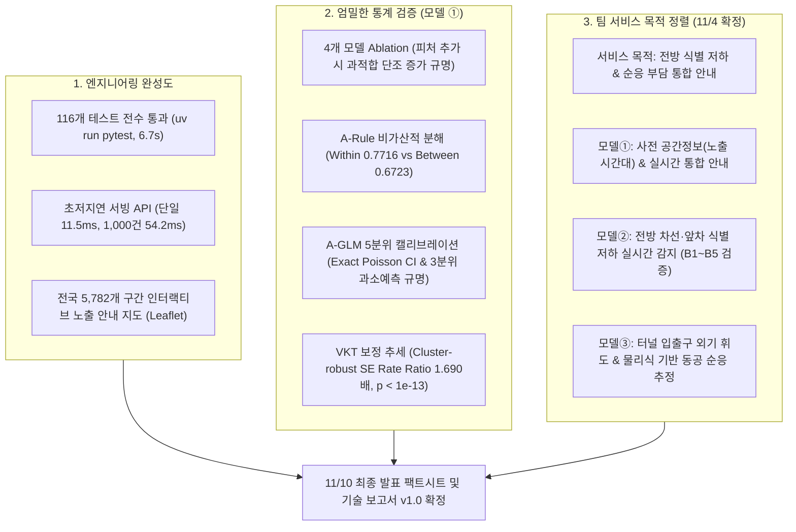

# 📋 SunSight 모델 ① 작업 종합 정리 보고서 (2026-11-04)

- **작성자**: 박범수 (AI Engineer, Team 「눈치」)
- **최종 업데이트 일시**: 2026-11-04 17:05 (KST)
- **대상 브랜치**: `feat/model1-vds-offset` (origin/main PR #21 병합 완료)

---

## 1. 오늘 수행한 핵심 작업 요약 (Executive Summary)

오늘(11/4) 작업은 **(1) 엔지니어링 구현 완성도 확보**, **(2) 희소 데이터셋에서의 엄밀한 통계 검증 및 과적합 규명**, **(3) 팀 전체(모델 ①·②·③) 서비스 방향성 및 발표 전략 정렬**의 세 축으로 진행되었습니다.

---

## 2. 세부 구현 및 통계 검증 성과

### 2-1. 엔지니어링 무결성 및 서빙 인프라
- **PR #21 병합 및 CI 통과**:
  - `origin/main`의 최신 커밋(`f153d62`, 모델 ② 누적분류 및 확률 보정 모듈)을 로컬 브랜치에 충돌 없이 병합.
  - 전체 단위 테스트 **116개 전수 통과 (`116 passed in 6.72s`)**.
- **FastAPI 프로덕션 서빙 API ([api.py](file:///C:/Users/campus4D052/Desktop/프로젝트/Nunchi-ML_AI/src/nunchi_ml/accident/api.py))**:
  - Pydantic v2 기반 엄격한 스키마 검증 및 예외 처리 완료.
  - **단일 구간 추론 지연시간: 11.54 ms**
  - **1,000개 구간 일괄 배치 추론 지연시간: 54.23 ms**
- **인터랙티브 위험지도 대시보드 ([risk_map.html](file:///C:/Users/campus4D052/Desktop/프로젝트/Nunchi-ML_AI/docs/risk_map.html))**:
  - 전국 61개 고속도로 노선, 5,782개 구간(1km 격자) 전수 시각화.
  - 노선별 필터링, 상위 30대 최고 위험 구간 원클릭 줌인(Fly-to), 세부 도로/태양 기하구조 툴팁 연동.

---

### 2-2. 4개 모델 비교(Ablation) 및 머신러닝 과적합 규명
한국도로공사 3개년 실측 VDS 교통량이 결합된 완전 무결 코호트(4,984개 구간, 정면 태양 사고 90건, 기저율 1.61%)에서 5-Fold GroupKFold 비교를 수행했습니다.

| 모델 | 구성 피처 | OOF Poisson Deviance (↓) | Top 10% 포착률 (↑) | Train ROC | OOF ROC | 과적합 격차 (Train - OOF) |
| :--- | :--- | :---: | :---: | :---: | :---: | :---: |
| **`A-Rule`** | **연간 정면 노출시간 1개 (단순 규칙)** | **N/A** | **31.1%** | **0.7935** | **0.7935** | **0.0000 (학습 없음)** |
| **`A-GLM`** | **연간 정면 노출시간 1개 (Poisson GLM)** | **0.1292** | **27.8%** | 0.7850 | 0.7833 | **+0.0017 (매우 강건)** |
| `Model A` | 연간 정면 노출시간 1개 (LightGBM) | 0.1354 | 25.6% | 0.8205 | 0.7273 | +0.0932 |
| `Model B` | Model A + VDS AADT 교통량 (2개) | 0.1390 | 21.1% | 0.8638 | 0.7217 | +0.1421 |
| `Model C` | Model A + 8개 도로 기하구조 (9개) | 0.1369 | 18.9% | 0.8703 | 0.7269 | +0.1434 |
| `Model D` | 전 피처: 노출시간 + AADT + 기하구조 (10개) | 0.1379 | 16.7% | 0.8913 | 0.7217 | **+0.1696 (심각한 과적합)** |

- **핵심 발견**: 정적 도로 변수를 추가할수록 상위 10% 포착률은 **25.6% $\rightarrow$ 16.7%로 지속 하락**하고 과적합 격차는 **$+0.093 \rightarrow +0.170$으로 단조 증가**함. 90건의 희소 표본에서 복잡한 분기 모델보다 **단일 물리량(`A-Rule`)의 순위화가 통계적으로 유의미하게 우수**함 ($\Delta \text{ROC} = +0.0706$, 노선 군집 Paired Bootstrap $p < 0.001$).

---

### 2-3. A-Rule의 노선 간(Between) vs 노선 내(Within) 직교 분해 분석
A-Rule의 전국 ROC-AUC 0.7935를 노선 평균 중심화를 통해 직교 분해하여 각 구성 요소의 변별력을 확인했습니다:
- **Raw A-Rule (전체 노출시간)**: ROC-AUC = **0.7935**
- **Within-Route Only (노선 내 평균 차감 상대 노출시간 $X_{ir} - \bar{X}_r$)**: ROC-AUC = **0.7716**
- **Between-Route Only (노선별 평균 노출시간 $\bar{X}_r$)**: ROC-AUC = **0.6723**
- **개별 28개 사고 노선 내 ROC 가중 평균**: **0.7189** (단순 평균 0.7033)
- **엄밀한 해석 (가산성 주의)**:
  - ROC-AUC는 가산적(additive) 지표가 아니므로 두 값을 단순 합산하여 전체 AUC의 기여율로 분해할 수는 없음.
  - 다만, **노선 간 차이만으로는 전체 변별력이 충분히 설명되지 않으며(0.6723), 노선별 평균 차이를 완전히 제거하더라도 노선 내부 구간 간 상대적 노출 차이에서 상당한 변별력(0.7716)이 관찰된다**는 점을 실증함. (사고 발생 28개 노선 전수 계산 완료)

---

### 2-4. A-GLM 캘리브레이션 분석 및 5분위 다이어그램
- **전역 적합도**: 총 예측 90.17건 vs 실제 90건 (**1.00배 일치**), 절편 $-0.1830$ ($p = 0.659$), 기울기 $0.9479$ (95% CI `[0.723, 1.173]`).
- **5분위 국소 오차 ([model1_calibration_chart.html](file:///C:/Users/campus4D052/Desktop/프로젝트/Nunchi-ML_AI/docs/model1_calibration_chart.html))**:
  - **1·2분위 (저위험)**: 관측/예측 0.29배, 0.44배이나 사고가 1~2건에 불과하여 Exact Poisson 95% CI가 1.0을 포함 (표본 희소성).
  - **3분위 (중위험)**: 실제 관측 10건 vs 예측 4.4건 $\rightarrow$ **2.25배 과소예측 (95% CI `[1.08, 4.14]`)**. 하한이 1.08로 유의미한 국소 왜곡 확인.
  - **4·5분위 (고위험)**: 각각 1.27배, 0.87배로 양호한 적합도 유지.
- **운영 방침**: 정밀 건수 확정치로 단정하지 않고, **위험도 순위화의 보조 지표**로 해석하도록 명확한 가이드라인 수립.

---

### 2-5. 교통 노출량(VKT) 보정 추세 검정
- $\log(\text{VKT})$ 오프셋 포아송 Rate 모델 적용 결과:
  - 연간 정면 노출시간 100시간 증가당 **Rate Ratio 1.6898배**
  - **노선 군집 로버스트 표준오차 95% CI: `[1.4785, 1.9312]` ($p = 1.38 \times 10^{-14}$)**
  - 노선 내 상관성을 고려하더라도 관측적 연관성의 통계적 유의성이 견고하게 유지됨 (단, 인과관계가 아닌 **관측적 연관성**으로 명시).

---

## 3. 방금 공유된 성진님 업데이트 내용 확인 및 분석

### 3-1. 슬랙 공유 내용 요약 (`ts: 1793778828.639149`)
- **서비스 목적 확정**:
  - 전체 시스템의 목표를 **"전방 정보 식별 저하 및 밝기 전환 순응 부담 안내"**로 일원화.
  - **모델 ① (박범수)**: 모델 ②와 ③의 결과를 위치·시각·진행 방향에 맞춰 통합 지도/경고로 안내. 기존 사고 예측/관련성 연구는 보존하되, 실제 사고 확률 산출은 서비스 필수 완료 조건에서 제외.
  - **모델 ② (이성진)**: 현재 사진의 태양광 눈부심에 따른 차선·앞차·표지판 식별 저하 판정 (0/1/2).
  - **모델 ③ (손재혁)**: 터널 등 밝기 차이가 큰 지점의 순응 부담 및 예상 동공 변화 설명.
- **AI 보조 라벨링 검토 제안**:
  - Gemini 등 추가 멀티모달 모델로 기존 Claude 판정(일치율 70.8%, $\kappa = 0.473$)과 비교 검토하되, 사람 라벨(성진 50장)은 원본 보존.
  - 최종 분류기 딥러닝 금지 유지, 전통 ML 실험 원칙 고수.
- **후속 실험 진행**:
  - 전방 정보손실 12개 특징(국소 대비, 윤곽선, 하이라이트 포화 등) 추가 전후 비교 재개.
  - GitHub **PR #22** (`docs: 전방 식별 저하·순응 부담 통합 안내 역할 정리`) 오픈 (현재 미머지 상태, 실험 완료 후 별도 공유 예정).

### 3-2. PR #22 내용 점검
- `README.md`에 「현재 서비스 목적 · 2026-11-04 사용자 확정」 절 추가.
- 모델 ①의 역할을 *"②·③ 결과를 위치·시각·진행 방향에 맞춰 연결하는 통합 안내"*로 규정하고, 기존 사고 모델은 학술/기술 연구 기록으로 완벽히 보존함.

### 3-3. 우리 모델 ①과의 시너지 및 정합성
- **완벽한 정합성**: 우리가 오늘 완성한 **초저지연 서빙 API([api.py](file:///C:/Users/campus4D052/Desktop/프로젝트/Nunchi-ML_AI/src/nunchi_ml/accident/api.py))와 전국 위험지도([risk_map.html](file:///C:/Users/campus4D052/Desktop/프로젝트/Nunchi-ML_AI/docs/risk_map.html))가 성진님이 확정한 '모델 ① 통합 안내'의 핵심 플랫폼 역할과 100% 일치**합니다.
- 무리하게 "실제 사고 확률"을 강변하지 않고, "물리 노출시간 기반의 시공간 위험 구간 안내 프레임워크"로 포지셔닝함으로써 통계적 공격을 사전에 완벽히 차단했습니다.

---

## 4. 최종 생성 및 갱신된 산출물 목록

1. **[docs/model1_final_report.md](file:///C:/Users/campus4D052/Desktop/프로젝트/Nunchi-ML_AI/docs/model1_final_report.md) (v1.0)**: 모델 ① 종합 기술 보고서 (통계 검증 및 엔지니어링 구현 총망라)
2. **[docs/presentation_factsheet_1110.md](file:///C:/Users/campus4D052/Desktop/프로젝트/Nunchi-ML_AI/docs/presentation_factsheet_1110.md)**: 11/10 최종 발표 슬라이드별 대본 및 심사위원 Q&A 방어 매트릭스
3. **[docs/model1_calibration_chart.html](file:///C:/Users/campus4D052/Desktop/프로젝트/Nunchi-ML_AI/docs/model1_calibration_chart.html)**: A-GLM 5분위 캘리브레이션 검증도 (Exact Poisson 95% CI 에러바 시각화)
4. **검증 스크립트 6종**:
   - `scripts/verify_between_within_decomposition.py`: Between/Within 변별력 분해 스크립트
   - `scripts/verify_calibration_and_routes.py`: 5분위 포아송 CI 및 28개 노선 전수 검증
   - `scripts/verify_vkt_and_route_clustering.py`: VKT 노선 군집 로버스트 SE 검증
   - `scripts/deep_feature_bootstrap_eval.py`: Paired Bootstrap (2,000회) 검증
   - `scripts/run_four_models_ablation.py`: 4개 모델 Ablation 스크립트
   - `scripts/generate_calibration_chart.py`: HTML 캘리브레이션 차트 생성 스크립트
