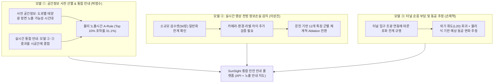

# 🎤 SunSight 11/10 최종 발표 팩트시트 및 질의응답 방어 자료

- **프로젝트명**: SunSight (고속도로 태양 역광 위험 구간 예측 및 실시간 눈부심 대응 시스템)
- **작성일**: 2026-11-04
- **대상**: 11/10 최종 평가 및 질의응답 (Team 「눈치」)

---

## 1. 3대 핵심 내러티브 요약 (Core Narrative)

> **"본 프로젝트는 실제 사고 확률을 산출하는 예측 시스템이 아니라, 태양광 정면 노출과 터널 진출입 밝기 변화에 따른 운전자 시각정보 저하 가능성을 사전에 안내하고 실시간 영상 감지 결과와 결합하는 시공간 기반 프레임워크를 제안합니다.**  
> **모델 ①은 전국 도로 구간의 태양광 노출 정보를 구축하고, 모델 ②·③은 각각 영상 기반 눈부심 감지와 밝기 전환 순응 부담 설명을 담당합니다. 현재 검증 결과는 공간적 노출 선별의 가능성을 보여주지만, 실시간 감지와 실제 운전자 시각 성능 간 연결은 추가 검증이 필요합니다."**

---

## 2. 슬라이드별 핵심 발표 스크립트 (Slide-by-Slide Deck Outline)

### 슬라이드 01. 프로젝트 개요 및 서비스 목적
- **핵심 메시지**: 태양광 정면 노출 및 터널 진출입 명암 급변에 따른 운전자 시각정보 저하와 순응 부담을 종합 안내하는 시공간 안전 프레임워크.
- **시스템 구성**:
  - **모델 ① (공간정보 사전 선별 & 통합 안내)**: 전국 고속도로 1km 구간별 태양광 정면 노출 가능성과 취약 시간대를 사전 분석하고, 모델 ②·③의 결과를 위치·시각·방향과 결합하여 안내.
  - **모델 ② (실시간 전방 정보손실 감지)**: 주행 영상에서 태양광 눈부심으로 인한 차선·앞차·표지판 식별 저하 정도를 실시간 분류 (0/1/2 단계).
  - **모델 ③ (밝기 전환 순응 부담 설명)**: 터널 진출입 등 밝기 급변 지점의 외부 밝기($L_{20}$) 추정 및 물리식 기반 예상 동공 변화 시각화 안내.

---

### 슬라이드 02. [엔지니어링] 소프트웨어 구현 완성도 검증
- **핵심 메시지**: 단위 테스트 116개 전수 통과와 초저지연 서빙 API 및 인터랙티브 노출 안내 지도 완성. (단, 엔지니어링 테스트는 코드와 API의 소프트웨어적 무결성을 증명하는 지표이며, 운전자 안전 개선이나 감지 정확도 자체를 증명하는 것은 아님을 명시)
- **실측 수치**:
  - **단위 테스트**: 116개 테스트 전수 통과 (`uv run pytest`, 6.72초 소요).
  - **추론 API**: 단일 구간 **11.54 ms**, 1,000개 구간 일괄 배치 **54.23 ms** (`src/nunchi_ml/accident/api.py`).
  - **전국 태양광 노출 안내 지도**: 전국 61개 노선, 5,782개 구간 인터랙티브 Leaflet 시각화 (`docs/risk_map.html`). (실제 사고 확률 지도가 아닌, **태양광 정면 노출 안내 지도**로 규정)
- **발표 강조점**: 
  - *"테스트 PASS는 코드와 API의 소프트웨어적 무결성을 증명하는 것이며, 실제 운전자 안전성 및 예측 타당성은 별개의 통계적 검증과 외부 실증으로 분리해 평가해야 합니다."*
  - *"현재 API와 위험지도는 모델 ①의 사전 공간정보 서빙 및 통합 인터페이스 규격이 구현된 단계이며, 모델 ②·③의 실시간 동적 추론 결과를 실시간 스트리밍으로 결합하는 것은 데이터 인터페이스 정의 후속 과제입니다."*

---

### 슬라이드 03. [모델 ①] 데이터 희소성과 단순 물리 규칙의 우위
- **핵심 메시지**: 90건의 극단적 희소 사고(기저율 1.6%) 데이터에서, 10개 피처 LightGBM은 과적합을 겪은 반면 **단순 물리 노출시간 기반 순위화(`A-Rule`)가 뛰어난 위험 포착률을 달성함.**
- **실측 수치**:
  - **상위 10% 위험 포착률**: `A-Rule` **31.1%** vs `Model D (10개 피처)` **16.7%** (**+14.4%p 우위**).
  - **ROC-AUC**: `A-Rule` **0.7935** (95% CI: `[0.7280, 0.8434]`) vs `Model D` **0.7217**.
  - **노선 간 vs 노선 내 직교 분해 비교 (Non-additive Decomposition)**:
    - **Within-Route Only (노선 내 평균 차감 상대 노출시간)**: ROC-AUC = **0.7716** (노선 평균 차이를 완전히 제거해도 노선 내부 구간 간 상당한 변별력 유지)
    - **Between-Route Only (노선 평균 노출시간)**: ROC-AUC = **0.6723** (노선 평균 차이만으로는 전체 변별력이 충분히 설명되지 않음)
    - **개별 28개 노선 내 ROC 가중 평균**: **0.7189** (단순 평균 0.7033)
  - **과적합 격차**: Model D의 Train-OOF 격차는 `+0.1696`에 달한 반면, `A-Rule`은 학습 과정이 없어 일반화 성능이 보존됨.
  - **노선 군집 Paired Bootstrap (2,000회)**: ROC-AUC 차이 부트스트랩 평균 `+0.0706` (95% CI: `[+0.0421, +0.0994]`, $p < 0.001$).
- **권장 발표 문구**:
  > *"단순 물리 노출시간 기반 위험 순위화(`A-Rule`)는 10개 피처 LightGBM보다 높은 사고 포착률을 기록했습니다. 노선 간 차이만으로는 전체 변별력이 설명되지 않으며, 노선 내부 구간 간 상대적 노출 차이에서도 상당한 변별력(0.7716)이 관찰됩니다. 노선 군집 Bootstrap에서 ROC-AUC 차이의 95% 신뢰구간이 0을 포함하지 않았습니다. (단, 이 신뢰구간은 고정된 OOF 예측값에 대한 노선 재표본화 결과이며 모델 재학습까지 포함한 불확실성은 아닙니다.)"*

---

### 슬라이드 04. [모델 ①] 노출량 보정과 캘리브레이션의 국소적 한계
- **핵심 메시지**: 통행량(VKT)을 통제하더라도 태양 노출시간과 사고율 간에 유의미한 관측적 연관성이 유지됨. 단, 정밀 건수 예측 모델(`A-GLM`)은 전역적으로 양호하나 국소적 오차가 존재함.
- **실측 수치**:
  - **교통 노출량(VKT) 보정 포아송 추세**: 연간 정면 노출시간 100시간 증가당 **Rate Ratio 1.690배** (노선 군집 로버스트 SE 95% CI: `[1.479, 1.931]`, $p = 1.38 \times 10^{-14}$). 노선 내 상관성을 고려한 로버스트 표준오차에서도 관측적 연관성의 통계적 유의성이 유지됨.
  - **전역 캘리브레이션**: 총 관측 90건 vs OOF 총 예측 90.17건 (1.00배 적합), 절편 $-0.183$ ($p = 0.659$).
  - **5분위 국소 캘리브레이션 시각화 ([model1_calibration_chart.html](file:///C:/Users/campus4D052/Desktop/프로젝트/Nunchi-ML_AI/docs/model1_calibration_chart.html))**: 중간 위험 구간(3분위)에서 실제 관측 10건 vs 예측 4.4건으로 **2.25배 과소예측** (Exact Poisson 95% CI: `[1.08, 4.14]`). 1·2분위는 사고 1~2건으로 표본 희소성에 따른 넓은 신뢰구간을 가짐.
- **권장 발표 문구**:
  > *"VKT를 offset으로 통제한 Poisson 분석에서 정면 태양 노출시간과 사고 발생률 간 유의한 관측적 연관성이 확인되었습니다. 다만 예측 분위별 캘리브레이션에서 중간 위험 구간의 과소예측 등 국소적 오차가 존재하여, 현재 모델을 정밀 사고 건수 예측보다는 위험 선별의 보조 지표로 해석합니다."*

---

### 슬라이드 05. [모델 ②] 영상 모델의 일반화 한계 및 체계적 특징 실험 계획
- **핵심 메시지**: 실시간 카메라 영상 기반 눈부심 분류기(이성진 담당)의 소규모 검수셋(50장) 평가에서 일반화 성능 저하가 확인되었으며, 이를 단순한 '카메라 도메인 편향'으로 단정하기보다 환경·라벨·클래스 불균형이 복합된 기술적 과제로 규명하고 문헌 기반 특징군 체계적 실험으로 전환함.
- **성진 50장 자체 검수셋 평가 실측치 (독립 탐색 시험)**:
  - **정답 구성 (Ground Truth)**: 정상 32장, 눈부심 8장, 심함 10장 (총 50장)
  - **LightGBM (학습 624장 모델, 상대 12개 피처)**:
    - **전체 정확도**: **0.540** (27/50) $\rightarrow$ **다수 클래스 기준선(Majority Class, 0.640)에 미달**
    - **Balanced Accuracy**: 0.531 | **3등급 Macro F1**: 0.3179
    - **심함(Severe) 재현율**: **0.200** (10장 중 단 2장만 포착)
    - **로지스틱 회귀 (상대 12개)**: 정확도 0.540, Macro F1 0.213, **심함 재현율 0.000**
    - **최선 단일 특징 규칙**: 정확도 0.580 (29/50)
  - **AI 판정(Claude)과의 불일치 패턴 (공통 48장)**:
    - 일치율: **70.8%** (34/48), 코헨 카파 $\kappa = 0.473$ (선형 $0.594$, 이차 $0.722$)
    - 사람 심함(10장) 중 AI는 7장을 '눈부심(1)'으로 하향 판정함.
- **엄밀한 해석 및 향후 체계적 실험 구조**:
  - 50장의 소규모 표본 저하는 카메라 차이뿐 아니라 라벨 불일치, 심함 표본 희소성이 복합된 결과임.
  - **Gemini 보조 라벨링**: 독립 정답이 아닌, 사람-AI 판정 불일치 원인 분석용 보조 도구로 엄격히 한정.
  - **추천 문헌 기반 전통 영상 12개 특징 Ablation 계획**:
    - `Baseline`: 현재 상대 12개 모델
    - `B1`: 밝기·포화 관련 특징
    - `B2`: 국소 대비(Local Contrast) 특징
    - `B3`: 윤곽선(Edge)·정보손실 특징
    - `B4`: $B1 + B2 + B3$ 결합 모델
    - `B5`: B4에서 각 특징군을 하나씩 제거하는 Group Ablation

---

### 슬라이드 06. [모델 ③] 터널 조광 연동 한계와 외기 휘도 직접 예측
- **핵심 메시지**: 터널 진입 시 동공 순응도($A$)를 영상으로 직접 추정하려던 초기 계획에서, 터널 입구 조명이 외부 밝기에 따라 자동 조광(Dimming)되어 입구 순응도가 좁은 범위(0.43~0.63)에 갇히는 문제를 발견함.
- **방향 전환 및 한계 명시**:
  - 모델 타깃을 인위적인 순응도($A$)가 아닌 **물리적 외기 휘도($L_{20}$)**로 재정의.
  - 영상 기반 외기 휘도 회귀 후, CIE 표준 및 생체 동공 물리식([Watson·Yellott, 2012](https://pubmed.ncbi.nlm.nih.gov/23012448/))을 결합하여 순응 부담을 계산하는 **물리-AI 융합 아키텍처** 채택.
  - **주의점**: 산출되는 동공 크기 및 순응 부담은 **실제 생체 측정값이 아니라 물리식에 기반한 이론적 추정치**임을 명확히 표기.

---

### 슬라이드 07. 종합 결론 및 배운 점 (Takeaway)
- **SunSight의 기술적 기여**:
  1. 기저율 1.6%의 극단적 불균형 사고 데이터에서 무리한 피처 추가 대신 도메인 물리량(`A-Rule`)의 강건성을 실증함.
  2. 예측 모델을 **순위화(`A-Rule`)**와 **건수 추정(`A-GLM`)**으로 명확히 이원화하여 행정적·공학적 실용성을 확보함.
  3. 소프트웨어 엔지니어링(테스트 116개 통과, 서빙 API, 웹 지도)과 엄밀한 통계적 한계를 구분하여 프로덕션 준비도를 갖춤.

---

## 3. 심사위원 질의응답 방어 매트릭스 (Anticipated Q&A)

### Q1. "왜 분류 모델의 기본 지표인 F1-Score를 메인 지표로 쓰지 않고 ROC-AUC와 Top 10% 포착률을 썼는가?"
> **답변 논리**:  
> "현재 분석 데이터셋은 4,984개 구간 중 실제 사고 발생 구간이 80개에 불과한 **1.61%의 극단적 희소 불균형 데이터**입니다.  
> 베이즈 정리에 따르면 특이도가 90%이고 재현율이 100%인 이상적인 모델도 정밀도는 약 14% 수준에 제한되며, 특정 임계값 하나로 결정되는 F1-Score는 임계값 이동에 따라 급변하여 모델의 전반적 변별력을 왜곡합니다.  
> 따라서 임계값 독립적인 순위화 성능을 나타내는 **ROC-AUC**와, 도로공사 등 행정 기관이 한정된 예산으로 상위 10% 위험 구간을 집중 점검할 때 실제 사고의 몇 %를 예방할 수 있는지를 직관적으로 보여주는 **상위 10% 사고 포착률(Top 10% Recall)**을 주 평가지표로 채택했습니다."

---

### Q2. "A-GLM의 전체 캘리브레이션 기울기가 0.948이라면서, 왜 3분위에서는 2.25배나 과소예측하는가? 모델에 결함이 있는 것 아닌가?"
> **답변 논리**:  
> "매우 날카로운 지적이며 저희도 그 한계를 확인했습니다.  
> 전체 캘리브레이션 기울기 0.948(95% CI [0.723, 1.173])과 절편 -0.183은 전역적인 적합도와 총량 일치(90.17건 vs 90건)를 보여주지만, 분위별 국소 적합도까지 완벽함을 보장하지는 못합니다.  
> 특히 3분위는 실제 사고 10건 대비 4.4건만 예측하여 2.25배(95% CI [1.08, 4.14])로 유의미하게 과소예측했습니다. 반면 1·2분위는 사고 건수가 각각 1~2건에 불과해 넓은 신뢰구간을 가집니다.  
> 이는 단일 지수함수 기반의 GLM이 중간 위험 구간의 비선형적인 사고 집중을 완전히 설명하지 못한다는 점을 시사하며, 바로 이 때문에 저희는 **이 모델을 정밀한 사고 건수 예측기로 단정하지 않고, 상대적 위험 구간 선별의 보조 지표로 해석해야 한다**고 명확히 한계를 규정했습니다."

---

### Q3. "노선별 A-Rule ROC-AUC를 보면 경부선(0.85)은 높은데 영동선(0.55)은 무작위에 가깝다. 노선에 따라 성능이 왜 이렇게 갈리는가?"
> **답변 논리**:  
> "그 차이는 고속도로의 선형(방위각) 특성 때문입니다.  
> 영동고속도로는 노선 전체가 동서축으로 뻗어 있어, 거의 모든 구간이 일출·일몰 시간대에 고르게 높은 정면 태양 노출시간을 갖습니다. 따라서 노선 '내부'에서는 노출시간만으로 사고 구간과 무사고 구간을 변별하기 어렵습니다.  
> 반면 경부고속도로, 중앙고속도로처럼 남북축으로 주행하다 굴곡부에 따라 정면 역광이 집중되는 노선에서는 태양 노출시간이 사고 발생 구간을 매우 뚜렷하게 분리해냅니다(경부 0.8502, 논산천안 0.8097, 중앙 0.9265).  
> 전국 통합 풀링 ROC-AUC가 0.7935로 높은 이유는, 이 모델이 노선 내부의 곡선부 위험뿐만 아니라 태양 노출이 많은 동서축 노선(남해선, 영동선 등) 자체를 고위험 노선으로 올바르게 상위 랭크하기 때문입니다."

---

### Q4. "연간 정면 노출시간 100시간 증가당 Rate Ratio가 1.690배라는 결과가 태양 역광이 사고의 직접 원인이라는 인과관계를 증명하는가?"
> **답변 논리**:  
> "증명하지 않습니다. 본 분석은 **교통 노출량(VKT)을 $\log(\text{VKT})$ 오프셋으로 통제한 상태에서도 태양 역광 노출시간과 사고 발생률 사이에 통계적으로 강력한 연관성(노선 군집 SE 보정 $p < 10^{-13}$)이 관찰된다는 실증적 연관성을 확인한 것**입니다.  
> 실제 사고는 운전자 졸음, 스마트폰 주시 태만, 기상 조건, 차량 속도 등 다양한 교란 변수가 복합적으로 작용하므로, 이를 인과적 위험비로 단정하지 않고 관측적 연관성으로 엄밀히 구분하여 보고서에 기술했습니다."

---

### Q5. "단위 테스트 116개가 통과되었다는 것이 모델의 실제 도로 안전성까지 보장하는가?"
> **답변 논리**:  
> "보장하지 않습니다. 테스트 116개 통과, 54ms 배치 서빙 API 구현, 웹 위험지도는 **소프트웨어 엔지니어링 관점에서의 구현 완성도와 배포 준비도(Production Readiness)**를 검증한 것입니다.  
> 모델의 실제 도로 예측 유효성은 엔지니어링 테스트와 별개로, **5-Fold Route GroupKFold 교차검증, 노선 군집 2,000회 Paired Bootstrap, Poisson Calibration 분석**이라는 통계학적 검증 절차를 통해 독립적으로 평가하였습니다."
